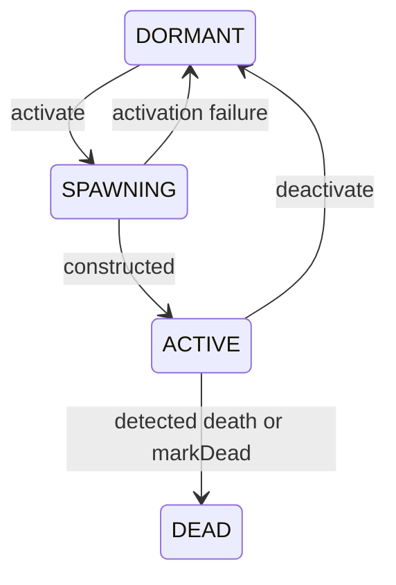

# NPC profiles, activity ownership and logical lifecycle

Status: implemented for server Build 42.21.0; regression fixtures and game-JAR
dry compilation pass. Awaiting live dedicated-server validation. Shared modules and
PostgreSQL persistence are now implemented; the current storage, setup and module
contracts are in [NPC-PERSISTENCE.md](NPC-PERSISTENCE.md).

## Identity and configuration

`ServerHumanDefinition.key` identifies one logical NPC. `displayName` is only
presentation; `profileId` selects a registered behavior profile independently
of that key. A guide named Ricardao can use `lobby-guide`; multiple logical NPCs
may use that same profile with independent runtime state.

The existing nine-argument definition constructor remains source-compatible and
selects `roaming-greeter`. It never derives behavior from the actor key. The JVM
startup guide explicitly selects `lobby-guide`; override it using
`-Dapocbr.guide.profile=<registered-id>`. The remaining guide JVM settings retain
their existing meaning. This bootstrap creates the initial actor;
PostgreSQL intake calls the same generic logical registration API.

`HumanProfile` is immutable data: `id`, positive `revision`, allowlisted
`behaviorId`, immutable millisecond `parameters`, `greetingKey`,
`announcementId`, and `dialogue`/`trading` capability flags. It contains no live
Java world objects, visitors, executors or function references. Factories and
content adapters are registered in code separately from this data.

| Built-in profile | Behavior | Announcement source | Dialogue | Trading |
| --- | --- | --- | --- | --- |
| `lobby-guide` | Shared greet + roam modules | `operations` | Yes | Yes |
| `roaming-greeter` | Shared greet + roam modules | `none` | Yes | Yes |
| `stationary` | Independent `IdleBehavior` | `none` | Yes | No |

`ServerHumanProfiles` is the production composition root. `HumanProfileRegistry`
separates behavior-factory registration from profile-data registration. Duplicate
IDs, unknown behavior/provider IDs and invalid behavior-specific parameters fail
before acceptance. `replace` requires a strictly newer revision and validates
before replacing the accepted snapshot. Each factory invocation constructs a
fresh behavior; mutable behavior instances must never be shared across NPCs.

Active actors retain their bound profile revision. Dormant reactivation resolves
the latest accepted profile. There is no mid-action hot swap of live policies.
Profile registry methods synchronize configuration access, but world activation
and removal remain simulation-thread-only.

Guide parameter keys are `roamPauseMs` (3000), `attentionMs` (1000),
`salutationMs` (2500), `cooldownMs` (3000), `visitorCooldownMs` (120000), and
`announcementPauseMs` (4000). Durations must be between zero and one day;
salutation must be positive. Unknown keys are rejected, and converted to
nanoseconds only after validation. The idle behavior accepts no timing/speech
configuration. Registry data updates do not add executable database code.

### Registering an additional data profile

```java
var profiles = ServerHumanProfiles.registry();
profiles.register(new HumanProfile(
    "quiet-guide", 1, "guide",
    Map.of("announcementPauseMs", 6000L, "visitorCooldownMs", 180000L),
    "IGUI_ApocExtractionMapUtils_GuideHello", "operations", true, false
));
// Construct ServerHumanDefinition with profileId="quiet-guide", then register/activate it.
```

This creates another policy configuration using the existing guide behavior;
no new executor or actuator subclass is needed. A different algorithm registers
its own allowlisted behavior factory through `registerBehavior`, implementing
`HumanBehavior`. A database editor can maintain the same data fields and
advance `revision`; it cannot install arbitrary Java functions. Existing dialogue
option content remains in the server Lua registry keyed by logical NPC identity.

## Active control and execution

`ServerHuman` holds a generic `HumanActivityController`, not `GuideBrain`.
`HumanBehavior` defines autonomous `update`, `suspend`, `resume`, `stop`,
availability and perception requirements. The controller owns mutually exclusive
`AUTONOMOUS`, `DIALOGUE`, `TRADE`, `RECORDING_SALE` and `STOPPED` modes.

Dialogue and trade services keep their existing authenticated connection,
distance, token, consent, receipt and timeout validation. They acquire/release
the controller rather than invoking guide-specific state transitions. An
unrelated finish cannot release another interaction. While an interaction owns
control, autonomous policy is not ticked. Releasing it calls the selected
behavior's resume policy. For the guide this preserves visitor cooldown and
returns to its post before roaming; the stationary profile stays stationary.
Profile-disabled dialogue is excluded from the public roster and rejected at
the Java boundary; profile-disabled trade is rejected before trade work starts.

`GuideBrain` contains only autonomous policy states: idle, roaming, facing,
attention, saluting, speaking, suspended, returning, cooldown and stopped. Its
timings and greeting/announcement content are injected. A custom behavior failure
stops only its controller, records the failure class, attempts capability cleanup
and does not retry that broken policy on every tick. Stationary autonomous
behavior does not request visitor/world perception scans.

The legacy `greet()` actuator method and `Emote.greet` flag have been removed.
Greeting is now a generic `Parallel(Emote, Say)` plan: the wave and validated
speech start in the same update, and the plan remains running until the animation
finishes. Parallel presentation groups allow at most one animation and one speech
lane; competing movement, duplicate lanes and nested arbitrary groups are
rejected. Failure or cancellation cleans active lanes. Ordered announcements
continue to use bounded `Sequence(Say, Wait, Say)` actions. No role-specific text
or actor-key decision is left in the actuator or action executor.

## Outer lifecycle

`HumanLifecycle` retains logical definition, state, successful activation count and last bound profile revision
independently of the active `ServerHuman`. Its read API returns immutable
`HumanLifecycle.Snapshot` values captured by the independent NPC storage adapter.



Simulation-thread APIs on `ServerHumanFactory`:

| API | Behavior |
| --- | --- |
| `registerDormant(definition)` | Validate profile/name/identity and retain a logical NPC without creating an `IsoPlayer`. |
| `activate(key)` | Construct the selected profile/runtime and presentation; commit ACTIVE only after construction. |
| `spawn(definition)` | Compatibility convenience for register plus activate. |
| `deactivate(key)` | Remove live routing/presentation, stop control, close dialogue/trade and retain DORMANT logical state. |
| `markDead(key)` | Remove the live actor and enter terminal DEAD. |
| `lifecycle(key)` | Return an immutable logical snapshot, or null. |
| `remove(key)` | Permanent administrative removal, including dormant/dead records. |

The factory detects an active presentation's death on the simulation thread.
Existing built-ins remain invulnerable through the existing presentation setup;
`markDead` also supports explicit administrative lifecycle decisions. DEAD cannot
activate again. Spawning failure rolls back to DORMANT without counting a
successful activation. A failed `spawn` can leave its registered logical record
dormant for inspection/retry. Unknown profiles fail before logical registration.

Runtime disposal stops control before releasing feature sessions, preventing
session-close callbacks from resuming autonomy during teardown. Disposal is
idempotent. Only active presentations are advertised in the pushed dialogue
roster. Successful activation/deactivation invalidates that cache through the
existing roster lifecycle event.

Dormancy is explicitly requested; no new distance/relevance scheduler or offline
simulation is enabled. Reactivation starts a fresh runtime at the definition's
spawn coordinates, with fresh ephemeral visitor cooldowns and current profile
revision. It allocates a fresh presentation ID. The existing no-reuse policy,
name reservations and **64 total presentation IDs per server process** remain in
force. This prevents delayed packets from targeting a different incarnation;
automatic activation churn must wait for a separately validated transport/ID
policy. Logical keys/profile IDs, not presentation IDs, are the storage keys.

## PostgreSQL persistence

The worker, migration, profile/module schema, mutation snapshots and ownership
fence are implemented. See [NPC-PERSISTENCE.md](NPC-PERSISTENCE.md) for setup,
maintenance transactions, limits, restart semantics, failure handling and tests.
NPCs never enter the player persistence graph; existing trade receipts retain
their established transactional flow. The user applies the new V15 migration;
no live database has been changed.

## Verification

`python tools/test_human_profiles.py` passes 56 assertions and executes the production registry,
composition root, behavior/controller and factory/lifecycle with engine boundary
stubs. It covers profile validation/revision isolation, independent behavior
instances, generic exclusive control, disabled capabilities, faulty policy
containment, parallel failure, independent actor key/profile selection,
dormancy/reactivation, fresh presentation IDs, terminal death, active profile
revision retention and activation failure rollback.

Also run existing brain, sequence, dialogue, trade, roaming, server-human and
event-controller fixtures. `42.21.0/patchApocalipseBr.ps1 -DryRun` compiles the
changed custom sources against the actual 42.21.0 game JAR without deployment.
Validate appearance, wave/chat timing, profile-specific interactions, despawn/
reactivation synchronization and client roster replacement on a dedicated
server. No live runtime behavior or PostgreSQL integration is claimed by mocks.

Related: [architecture contract](NPC-ENGINE-ARCHITECTURE.md),
[server-owned humans](SERVER-HUMANS.md), [NPC dialogue](NPC-DIALOGUE.md).


## A-Life comparison before the PostgreSQL migration

The installed Project A-Life source uses a common actor/runtime, distinct NPC
templates and behavior presets, registered priority-ordered modules, shared
perception and layered relationships. The current single behavior-factory
selection is a baseline for a module pipeline, not the final persistence schema.
Read the [source investigation and proposed form/data model](docs/npc-alife-runtime-investigation.md)
before creating the initial migration and guide seed. That report distinguishes
verified A-Life behavior from proposed extensions and preserves the existing
lifecycle/activity/execution boundaries.

The A-Life investigation predates implementation; its proposed model is now refined by [the implemented storage/module contract](NPC-PERSISTENCE.md).
