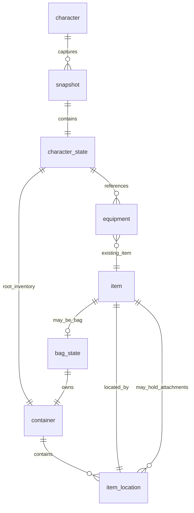

# Player relational persistence contract — 42.21.0

Status: initial SQLite-load capture, receipt-check worker and V5 JDBC writes are
implemented. Mutation tracking and a relational loader are not implemented.
The backend V5 migration supplies the 63-table contract. First phase is an asynchronous relational
backfill from the native SQLite `players.db` store, which remains authoritative.
`ApocBRPlayerDatabase.enabled()` defaults to false: the master PostgreSQL switch
does not select the PostgreSQL player byte store. Existing explicit
`apocbr.postgres.players.enabled=true` settings must be removed or set false.
After successful SQLite deserialization and native state restoration, schedule the
completed character for immutable capture and asynchronous relational persistence.
Do not remove existing byte stores or change native profile packets in this phase.

This document specifies the tables the backend agent can create. The less common
component families below deliberately use typed relational nodes, rather than
pretending every dynamic game component already has an audited fixed schema.
Those families require codecs before a character can be certified complete.

## Implemented initial-load path

`ServerPlayerDB.serverLoadNetworkCharacter` calls
`ApocBRPlayerRelationalSync.offerLoadedPlayer` only in the successful SQLite branch,
after deserialization and dead/remote state restoration. Native return values and
byte saving remain unchanged. No hook is installed in the PostgreSQL byte-load
branch, profile response packet, constructors, or new-character creation path.
Newly created players become eligible when subsequently loaded from SQLite;
automatic respawn/incarnation transition detection is not implemented in this phase.

The load hook copies the export fields into a detached, bounded snapshot and
nonblockingly enqueues it with immutable provenance inputs. It returns without
waiting for JDBC or relational projection. No live player/item/container/Lua-table
references are retained. The export worker checks the slot/head receipt, resolves
item aliases, builds and validates the relational graph from that snapshot, then
persists it. There is no `ServerMap.preupdate` capture pump. A complete receipt
skips graph projection and writes; copying the offered snapshot still occurs
before that asynchronous receipt check. The snapshot represents the completed
SQLite load at the offer hook, including native dead/remote restoration. Offline
inspection loads use the same detached-copy path.

The owning/load thread still pays for reading and copying relevant fields and
collections; mutable engine state cannot safely be copied by an unsynchronized
worker. Snapshot copying does not construct SQL rows, assign relational UUIDs,
resolve database aliases, deserialize another player or wait for the exporter.
Native registry keys and recorded-media identities are resolved while copying;
only scalar values, private snapshot nodes and copied collections/bytes cross the
queue. Snapshot copying preserves item identity for equipment and cycle validation.

`InventoryItem` and `GameEntity` report swallowed failures into a scoped quality
collector during SQLite player load. Skipped items, length mismatches, failed item
loads and skipped/failed components prevent completion. Unsupported components,
embedded animals and opaque native byteData produce an incomplete snapshot and
sync issues, with no new head. Other field/graph/capture failures abort the export
without changing the SQLite result. No claim of lossless relational reconstruction
is made: that loader does not exist yet.

The fixed column catalog in `ApocBRPlayerRelationalSchema` is pinned to backend V5;
the fixture checks it against that migration when the sibling backend checkout is
available. Scalar fields include private native state through cached, version-pinned
reflection in a separate helper, preserving the vanilla player/item APIs. Missing
fields fail capture instead of becoming zero/defaults. Item types/traits/professions/
perks/body locations use stable names, while numeric source IDs remain metadata.
Fluids and Durability have typed component codecs; all other component families
currently require explicit codec additions before they can be complete.

Configuration (JVM options before the main class):

```text
-Dapocbr.postgres.enabled=true
-Dapocbr.postgres.players.enabled=false
-Dapocbr.postgres.vehicles.enabled=false
-Dapocbr.postgres.playerRelational.enabled=true
```

Use the existing complete JDBC URL/pool configuration. Relational sync defaults
to enabled when the master connector is enabled and SQLite players are selected;
the authoritative PostgreSQL player byte-store flag still defaults to false.
`apocbr.postgres.playerRelational.sourceDatasetId=<UUID>` optionally pins source
identity across moving the save directory. Otherwise it derives from the current
save-directory string. Preserve that ID when moving the same save; assign a new
one for a different save. Dictionary/mod hashes are currently explicitly unknown
(NULL); source blob hashes identify the original SQLite input, not later mutations.
Do not merge independent saves with colliding native IDs/slot identities: the
existing V5 uniqueness constraints reject such collisions, and the exporter rejects
a head from a different source dataset.

Implemented limits supersede the proposed defaults later in this document:

- One daemon exporter/JDBC worker/lease, 16 pending candidates, 16 MiB estimated
  pending input memory including snapshots and copied SQLite source bytes.
  Snapshot and source-byte inputs are each capped at 2 MiB. The graph has its own
  2 MiB conservative row accounting; one graph is constructed at a time in addition
  to queued input memory. Collections are capped at 10,000 members, depth at 64,
  with 100,000 rows/nodes as additional upper bounds. Capacity and duplicate checks
  happen before reading player state. Full queues defer until another native load.
- Snapshot copying is synchronous at offer time and has no time-abort threshold.
  The queued snapshot is private and read-only; graph projection runs entirely on
  the worker with no capture time-abort threshold. The earlier capture-budget JVM
  settings are no longer used. Snapshot/projection size and graph validation
  limits remain enforced. Oversized snapshots fail the export, preserving the
  native SQLite load result. Copy/projection timings are measured independently;
  this change does not claim measured load-thread savings without runtime data.
- At most three worker attempts with 2/4-second backoff, 120-second candidate
  lifetime. Retries reuse the same detached load-time snapshot and recheck the
  database receipt/aliases. Expiration or exhausted attempts defer until another
  native load. There is no offline-player scan or durable retry spool.
- JDBC batches of 128 for graph rows, identities and aliases, 2-second statement
  timeout, 250 ms lock timeout, nonwaiting per-slot advisory lock, 15-second checked
  write budget. The graph commits in **one bounded transaction** because V5 deferred
  cyclic graph FKs cannot be split arbitrarily across staging commits. No public
  table locks/DDL or native-store writes. Transaction budgets are cooperative;
  an in-flight JDBC statement may extend them until its own timeout.
- Complete status and head publication commit together; partial exports never
  become the skip receipt. An expected-head check rejects stale publication.
  Abandoned/superseded snapshot garbage collection is not implemented. Incomplete
  snapshots remain diagnostic and can be retried on later loads, so retention
  needs an operational policy before sustained production backfill.
- Shutdown stops/joins the exporter before shared pool closure. Pending work is
  rediscovered on a later load, not guaranteed flushed during shutdown.

Look for `[ApocBR][PlayerRelational]` messages: `worker started`, `SYNC_SKIPPED`,
`SYNC_COMPLETE`, `SYNC_INCOMPLETE`, `CHECK_FAILURE`, `SQL_FAILURE`, `CAPTURE_FAILED`,
and `QUEUE_FULL`. Errors expose SQLState or controlled capture codes, not driver
messages or player payloads. There are no per-item success logs.
`CAPTURE_COMPLETE` logs `snapshotMs` (load-thread copy), `projectionMs` (worker
relational projection), and item/row/byte counts before attempting JDBC writes.
This keeps projection measurements visible even if SQL writes fail. JDBC
write/statement timeouts remain enforced independently. Snapshot failures report
`OFFER_FAILED`; graph projection failures report `CAPTURE_FAILED`.

Validation: `python tools/test_postgres_player_relational.py` compiles the actual
snapshot/projection/JDBC/worker code. It checks V5 drift, native accessor
compatibility, detached nested bag/equipment graph parity, preservation of the
load timestamp, scalar/inventory/Lua/byte-buffer mutation isolation, rejection of
cycles and oversized snapshots, absence of live game objects in snapshots, alias
reuse, batched commit/rollback, incomplete/stale publication, source-dataset
mismatch, quality scopes, duplicate coalescing and asynchronous skip/first-sync
without a main-thread pump. Deterministic time-limit tests remain for the standalone
projection class, but production sync does not impose that time limit.
Actual native deserialization, modded data round trips, PostgreSQL constraint
execution, capture latency and queue saturation still require an isolated server
trial. These tests do not validate a future relational loader.

## Verified boundary

Follow these exact-version sources under `decompiled/zombie/`:

| Layer | Entry point | Responsibility |
| --- | --- | --- |
| Native server load | `savefile/ServerPlayerDB.serverLoadNetworkCharacter` | Load bytes/version for identity and slot; construct `IsoPlayer`; restore dead/remote state |
| Player | `characters/IsoPlayer.load:1245`, `save:1463` | Equipment references, survival, nutrition, fitness, reading/media/crafting, presentation, vehicle return hints |
| Character | `characters/IsoGameCharacter.load:5895`, `save:6033` | Descriptor, human visual, inventory, stats, wounds, XP, effects, recipes, cheats |
| Position/mod data | `iso/IsoMovingObject.load:684`, `save:724` | Position, direction, Lua table; this implementation does **not** call `IsoObject.load/save` |
| Container | `inventory/ItemContainer.load:2448`, `save:2435` | Ordered items, type, explored, looted, capacity |
| Item | `inventory/InventoryItem.loadItem:1887`, `load:1951`, `save:1663` | Framing, registry lookup, common state, subtype load, visual, components |
| Creation | `network/packets/character/CreatePlayerPacket.processServer` | Construct, apply traits/recipes, `OnNewGame`, native initial save |

`LoadPlayerProfilePacket` can return stored bytes without constructing a player.
It is not the backfill hook. Existing-player connection invokes the server loader;
the loaded character still needs final connection/identity association before a
live-object capture. Admin inventory inspection also loads offline characters:
do not mistake that for a new live owner or a new incarnation.

Constructing an item is not a persistence boundary. During load it is incomplete,
its containing bag may not yet exist, and equipment indexes are resolved later.
Capture **one completed character graph**, never one SQL validation per constructor.

## Conventions for migrations

Create a new schema `player_rel`; leave existing public tables unchanged.
Use PostgreSQL `uuid`, `text`, `boolean`, `integer`, `bigint`, `real`,
`double precision`, `timestamptz`, and `bytea` only where explicitly allowed below.
UUIDs are supplied by the engine/importer; no UUID extension is required.
Identifiers and names are case-sensitive unless a native identity rule says otherwise.
No `server_key` column. `source_dataset_id` below identifies an imported save's
provenance/dictionary, not a runtime server partition or an account authority.

All graph tables have `snapshot_id uuid NOT NULL` and reference `snapshot(id)`.
All field lists below include their remaining columns. `?` means nullable;
otherwise columns are NOT NULL. No default-zero policy for missing fields:
the codec emits the resolved native value, including defaults omitted in bytes.
An absent optional component is an absent row, distinct from a zero-valued component.

Unless specified otherwise, `player_id`, `character_id`, `object_id`, `item_id`,
`container_id`, `visual_id` and `component_id` are UUIDs, not native numeric IDs.
All graph FKs include `snapshot_id` to prohibit cross-generation references.
No automatic FK to `whitelist`: Steam/username authentication and character state
are separate contracts, and the account table does not define a character life.

## Identity, import provenance and publication

| Table | Columns / constraints |
| --- | --- |
| `source_dataset` | `id uuid PK`, `label text`, `world text`, `dictionary_sha256 text?`, `game_build text`, `mod_manifest_sha256 text?`, `created_at timestamptz`. Hashes represent original source context; unknown context is explicit, not inferred from the destination. |
| `player_slot` | `id uuid PK`, `legacy_networkplayer_id integer? UNIQUE`, `world text`, `identity_mode text CHECK IN ('username','steam_coop')`, `identity_key text`, `player_index integer CHECK BETWEEN 0 AND 3`, `username text?`, `steamid text?`, `split_username text?`, `active_character_id uuid?`, `created_at timestamptz`. UNIQUE `(world,identity_mode,identity_key,player_index)`. Duplicate native matches must be resolved before seeding, not silently merged. |
| `character` | `id uuid PK`, `player_slot_id uuid FK`, `incarnation integer CHECK > 0`, `created_at timestamptz`, `retired_at timestamptz?`, `retirement_reason text?`; UNIQUE `(player_slot_id,incarnation)`. Death/respawn is not an item-ID reuse opportunity. |
| `snapshot` | `id uuid PK`, `character_id uuid FK`, `source_dataset_id uuid FK`, `schema_version integer`, `codec_version integer`, `source_world_version integer`, `source_blob_sha256 text?`, `capture_revision bigint CHECK >= 0`, `capture_reason text`, `captured_at timestamptz`, `status text CHECK IN ('staging','complete','incomplete','failed','superseded')`, `expected_object_count integer`, `expected_item_count integer`, `expected_container_count integer`, `expected_edge_count integer`, `committed_at timestamptz?`. |
| `character_head` | `character_id uuid PK/FK`, `snapshot_id uuid UNIQUE`, `revision bigint CHECK >= 0`, `published_at timestamptz`. Composite FK `(character_id,snapshot_id)` to snapshot; add matching unique index on snapshot. Only a validated complete snapshot can become head (worker transaction; trigger may additionally enforce). |
| `sync_issue` | `id bigint GENERATED BY DEFAULT AS IDENTITY PK`, `snapshot_id uuid FK`, `object_id uuid?`, `code text`, `source_path text?`, `detail text?`, `created_at timestamptz`. Bounded, sanitized detail; no credentials or raw player bytes. |
| `object` | `snapshot_id`, `id uuid`, `kind text CHECK IN ('character','item','container','visual','component','embedded_entity')`; PK `(snapshot_id,id)`. Character object ID equals character ID. Subtype tables reference this registry. |
| `object_identity` | `id uuid PK`, `kind text`, `created_at timestamptz`, `retired_at timestamptz?`. Durable identity across snapshots. `object.id` references this table; enforce matching kind. |
| `source_item_alias` | `source_dataset_id uuid FK`, `character_id uuid FK`, `native_item_id integer`, `native_generation integer CHECK > 0`, `object_id uuid FK object_identity`, `created_at timestamptz`, `retired_at timestamptz?`; PK dataset/character/native_item_id/native_generation. Partial UNIQUE dataset/character/native_item_id WHERE retired_at IS NULL. Different owner aliases can reference the same UUID during an accepted transfer; alias retirement must be atomic with that transfer. |

Resolve the circular slot/character FK by creating tables first and adding
`player_slot.active_character_id` FK afterward. Enforce that the selected character
belongs to that slot. Do not derive a new incarnation from every login or load.
Initially imported legacy rows need a durable assigned incarnation. New-character
creation/respawn explicitly advances it; replacing a legacy row externally requires
an explicit import generation or review. A changing blob hash alone cannot detect
respawn, since ordinary saves also change that hash.

Graph object UUIDs survive recapture and future ownership transfers. Native item
integers are compatibility metadata, not global PKs. Assign/resolve object UUIDs
through a capture identity ledger; duplicate native item IDs in the same graph
are reported, never deduplicated by guessing. An initial deterministic mapping may
use source dataset + character incarnation + native ID **only after uniqueness is
validated**. Moving to another player must preserve the UUID, not recompute it.
The engine implementation must persist that ledger or stable IDs before claiming
identity continuity across fresh captures/process restarts.
`object_identity` and `source_item_alias` provide the database side of that ledger;
they do not magically distinguish two different native items that reuse an integer.
Reuse requires a new native_generation and UUID after explicit retirement. A
conflicting live alias is an identity issue to investigate, not an automatic merge.

## Ownership graph — items, containers and equipment



| Table | Columns / constraints |
| --- | --- |
| `container` | `snapshot_id`, `id uuid`, `native_id integer?`, `type text`, `explored boolean`, `has_been_looted boolean`, `capacity integer`, `owner_character_id uuid?`, `owner_item_id uuid?`; PK `(snapshot_id,id)`. Exactly one owner; root inventory owned by character, bag inventory owned by the bag item. UNIQUE owner character, UNIQUE owner item, each within snapshot. |
| `item` | `snapshot_id`, `id uuid`, `native_id integer`, `full_type text`, `runtime_class text`, `save_type integer`, `source_registry_id integer?`, `current_uses integer`, `condition integer`, `name text?`, `custom_name boolean`, `actual_weight real`, `custom_weight boolean`, `item_capacity real`, `activated boolean`, `have_been_repaired integer`, `custom_color boolean`, `color_r real`, `color_g real`, `color_b real`, `color_a real`, `key_id integer`, `remote_control_id integer`, `remote_range integer`, `worker text?`, `wet_cooldown real`, `favorite boolean`, `stash_map text?`, `zombie_infected boolean`, `current_ammo_count integer`, `attached_slot integer`, `attached_slot_type text?`, `attached_to_model text?`, `max_capacity integer`, `recorded_media_id text?`, `source_recorded_media_index integer?`, `world_scale real`, `initialised boolean`, `texture_name text?`, `model_index integer`, `world_x_rotation real`, `world_y_rotation real`, `world_z_rotation real`; PK `(snapshot_id,id)`. |
| `item_location` | `snapshot_id`, `item_id`, `container_id uuid?`, `parent_item_id uuid?`, `relation text CHECK IN ('container','weapon_attachment')`, `position integer CHECK >= 0`, `attachment_slot text?`; PK `(snapshot_id,item_id)`. Container relation requires only container FK; attachment requires only parent-item FK. Unique `(snapshot_id,container_id,position)` and `(snapshot_id,parent_item_id,position)` with partial indexes. Every item has exactly one owning location. |
| `equipment` | `snapshot_id`, `character_id`, `kind text CHECK IN ('hand','worn','attached')`, `slot text`, `item_id`, `position integer`; PK `(snapshot_id,character_id,kind,slot)`. Item FK; do **not** make item_id unique: the same two-handed weapon can occupy both hands. Worn slots use body-location resource strings, attached slots use named locations. |
| `bag_state` | `snapshot_id`, `item_id PK`, `container_id uuid UNIQUE`, `weight_reduction integer`. This is a subtype of item, not a separate copy of the bag. |
| `item_extra` | `snapshot_id`, `item_id`, `position integer`, `full_type text`; PK `(snapshot_id,item_id,position)`. Source `InventoryItem.extraItems`; type references, not owned item instances. |

Use `(snapshot_id,item_id)` as the actual PK wherever a row above says `item_id PK`.
`bag_state.container_id` must be the container whose owner_item_id is this item;
the worker validates this equivalence. Add FKs after all owning tables exist.
The root inventory is a normal container with owner_character_id; it has no bag row.

Validate acyclic containment, one root per character, reachability of all owned
objects, ownership exclusivity and equipment references before publication. SQL FKs
cannot alone prohibit a bag containing itself through multiple intermediate bags.
Equipment is a reference, never another ownership edge. Preserve collection order.
Do not compress identical items into counts: their identities and relationships matter.
The reviewed player save/load explicitly handles worn and hand references, not a
standalone attachedItems list. Capture `equipment.kind=attached` from the completed
runtime graph as supplemental state when available; do not claim a native load
necessarily reconstructs that list. Item-level attachedSlot fields are separate.

Example: backpack B resides in root R; equipment `worn/Back` references B; B owns
container C; pistol P resides in C; scope S is owned by P through a weapon-attachment
edge. There is one B, one C, one P and one S. A bag held in one hand and worn uses
two references to the same B if the native graph permits that combination.

Full type/resource strings are authoritative. Source numeric dictionary, body part,
perk, media and component IDs are diagnostics only. Resolve media identity through
the source recorded-media registry rather than assuming a short index is portable.

## Character fields and collections

All one-to-one character tables use PK/FK `(snapshot_id,character_id)`.
`character_state.inventory_container_id` references the root container.

| Table | Remaining columns |
| --- | --- |
| `character_state` | `character_id`, `inventory_container_id`, `x real`, `y real`, `z real`, `direction text`, `source_offset_x real?`, `source_offset_y real?`, `is_dead boolean`, `hours_survived double precision`, `zombie_kills integer`, `survivor_kills integer`, `asleep boolean`, `force_wake_up_time real`, `on_fire boolean`, `last_hour_slept integer`, `time_since_last_smoke real`, `beard_grow_timing real`, `hair_grow_timing real`, `last_animal_pet bigint`, `sneaking boolean`, `death_drag_down boolean`, `auto_drink boolean`, `voice_type integer`, `total_xp real`, `xp_level integer`, `xp_last_level integer`. |
| `character_descriptor` | `character_id`, `native_descriptor_id integer`, `forename text`, `surname text`, `torso text?`, `gender text`, `profession_key text?`, `voice_prefix text?`, `voice_pitch real`, `voice_type integer`. |
| `descriptor_extra` | `character_id`, `position integer`, `value text`; PK snapshot/character/position. |
| `character_effects` | `character_id`, `depress_effect real`, `depress_first_take_time real`, `beta_effect real`, `beta_delta real`, `pain_effect real`, `pain_delta real`, `sleeping_tablet_effect real`, `sleeping_tablet_delta real`, `reduce_infection_power real`. |
| `character_presentation` | `character_id`, `all_chat_muted boolean`, `tag_prefix text?`, `tag_r real`, `tag_g real`, `tag_b real`, `display_name text?`, `show_tag boolean`, `faction_pvp boolean`. |
| `character_vehicle_return` | `character_id`, `x real`, `y real`, `seat integer`, `running boolean`. Optional row; source stores coordinates/seat, not a stable vehicle FK. Do not invent a vehicle ID from these coordinates. |
| `character_stat` | `character_id`, `stat_key text`, `value real`; PK snapshot/character/stat_key. |
| `character_trait` | `character_id`, `trait_key text`; PK snapshot/character/trait_key. |
| `character_perk` | `character_id`, `perk_key text`, `xp real?`, `level integer?`, `descriptor_xp_boost integer?`, `multiplier real?`, `multiplier_min_level integer?`, `multiplier_max_level integer?`. PK snapshot/character/perk_key. Separate native maps are merged by perk key; null preserves absence in each map. |
| `character_recipe` | `character_id`, `position integer`, `recipe_key text`; PK snapshot/character/position. |
| `character_book_progress` | `character_id`, `position integer`, `full_type text`, `already_read_pages integer`; PK snapshot/character/position. |
| `character_read_book` | `character_id`, `position integer`, `full_type text`; PK snapshot/character/position. This is IsoPlayer.alreadyReadBook, distinct from page progress. |
| `character_literature` | `character_id`, `title text`, `day integer`; PK snapshot/character/title. |
| `character_print_media` | `character_id`, `position integer`, `media_id text`; PK snapshot/character/position. |
| `character_media_line` | `character_id`, `position integer`, `line_guid text`; PK snapshot/character/position. |
| `character_craft_history` | `character_id`, `recipe_key text`, `craft_count integer`, `last_craft_time double precision`; PK snapshot/character/recipe_key. Game-time value, not a SQL timestamp. |
| `character_mechanics` | `character_id`, `native_item_key bigint`, `native_value bigint`; PK snapshot/character/native_item_key. Native long-to-long map; preserve it without asserting a relational item FK. |
| `character_nutrition` | `character_id`, `calories real`, `proteins real`, `lipids real`, `carbohydrates real`, `weight real`. |
| `fitness_value` | `character_id`, `map_name text`, `key text`, `real_value real?`, `integer_value bigint?`; PK snapshot/character/map_name/key. Maps: stiffnessIncMap(real), stiffnessTimerMap(integer), regularityMap(real), exeTimer(bigint). Enforce the matching value column. |
| `fitness_body_part` | `character_id`, `position integer`, `body_part_key text`; PK snapshot/character/position. Source bodypartToIncStiffness. |
| `character_cheat` | `character_id`, `cheat_key text`, `enabled boolean`; PK snapshot/character/cheat_key. Store legacy explicit flags AND PlayerCheats set using separate key prefixes, not one guessed combined flag. Never use these rows to grant account capabilities. |

Stats saved by this build: Anger, Boredom, Discomfort, Endurance, Fatigue, Fitness,
FoodSickness, Hunger, Idleness, Intoxication, Morale, NicotineWithdrawal, Pain,
Panic, Poison, Sanity, Sickness, Stress, Temperature, Thirst, Unhappiness,
Wetness, ZombieFever, ZombieInfection (`CharacterStat.ORDERED_STATS`).

Legacy explicit cheats persisted by IsoGameCharacter: UnlimitedCarry, BuildCheat,
HealthCheat, MechanicsCheat, MovablesCheat, FarmingCheat, FishingCheat,
CanUseBrushTool, FastMoveCheat, TimedActionInstantCheat, UnlimitedEndurance,
UnlimitedAmmo, KnowAllRecipes. IsoPlayer also **writes** extra-info flags that its
load currently consumes without applying: GodMod, GhostMode, Invisible, NoClip,
ShowAdminTag, CanHearAll. Capture runtime values as `runtime.*` if available; do
not claim load reconstructed those historical bits. Old-version defaults follow
the native loader. Account policy remains authoritative for administrative rights.

Other asymmetries: moving-object offsets are consumed but not assigned in load;
source offsets therefore cannot be recovered from the loaded fields alone.
Some source records are clamped, skipped or defaulted by native loaders.
This is a capture of reconstructed state, not a byte-for-byte inverse decoder.
Record such provenance/quality differences explicitly.

## Health and appearance

| Table | Remaining columns |
| --- | --- |
| `body_damage` | `character_id`, `catch_a_cold real`, `has_a_cold boolean`, `cold_strength real`, `time_to_sneeze_or_cough integer`, `reduce_fake_infection boolean`, `health_from_food_timer real`, `pain_reduction real`, `cold_reduction real`, `infection_time real`, `infection_mortality_duration real`, `cold_damage_stage real`. |
| `body_part` | `character_id`, `body_part_key text`, `cut boolean`, `bitten boolean`, `scratched boolean`, `bandaged boolean`, `bleeding boolean`, `deep_wounded boolean`, `fake_infected boolean`, `infected boolean`, `health real`, `bandage_life real?`, `infected_wound boolean`, `wound_infection_level real?`, `cut_time real`, `bite_time real`, `scratch_time real`, `bleeding_time real`, `alcohol_level real`, `additional_pain real`, `deep_wound_time real`, `have_glass boolean`, `get_bandage_xp boolean`, `stitched boolean`, `stitch_time real`, `get_stitch_xp boolean`, `get_splint_xp boolean`, `fracture_time real`, `splint boolean`, `splint_factor real?`, `have_bullet boolean`, `burn_time real`, `need_burn_wash boolean`, `last_time_burn_wash real`, `splint_item text?`, `bandage_type text?`, `wetness real`, `stiffness real`, `comfrey_factor real`, `garlic_factor real`, `plantain_factor real`; PK snapshot/character/body_part_key. Native writes cutTime twice; one resolved field suffices. |
| `thermoregulator` | `character_id`, `set_point real`, `metabolic_rate real`, `metabolic_rate_real real`, `metabolic_target real`, `body_heat_delta real`, `core_heat_delta real`, `thermal_damage real`, `damage_counter real`, `thermal_duration real`. Optional row. |
| `thermal_node` | `character_id`, `body_part_key text`, `celcius real`, `skin_celcius real`, `heat_delta real`, `primary_delta real`, `secondary_delta real`, `insulation real`, `windresist real`, `body_wetness real`, `clothing_wetness real`; PK snapshot/character/body_part_key. Native spelling retained here. |
| `human_visual` | `character_id`, `hair_r integer?`, `hair_g integer?`, `hair_b integer?`, `beard_r integer?`, `beard_g integer?`, `beard_b integer?`, `skin_r integer?`, `skin_g integer?`, `skin_b integer?`, `body_hair integer`, `skin_texture integer`, `zombie_rot_stage integer`, `skin_texture_name text?`, `beard_model text?`, `hair_model text?`, `non_attached_hair text?`, `natural_hair_r integer?`, `natural_hair_g integer?`, `natural_hair_b integer?`, `natural_beard_r integer?`, `natural_beard_g integer?`, `natural_beard_b integer?`. Color bytes are normalized to unsigned 0..255. |
| `visual` | `snapshot_id`, `id uuid`, `owner_character_id uuid?`, `owner_item_id uuid?`, `position integer`, `full_type text?`, `alternate_model_name text?`, `clothing_item_name text?`, `tint_r integer?`, `tint_g integer?`, `tint_b integer?`, `base_texture integer?`, `texture_choice integer?`, `hue real?`, `decal text?`; PK snapshot/id. Exactly one owner. Character owner represents HumanVisual.bodyVisuals; item owner represents its optional ItemVisual. |
| `visual_body_value` | `snapshot_id`, `character_id uuid?`, `visual_id uuid?`, `channel text`, `body_part_key text`, `value integer`; exactly one owner; partial unique indexes per owner/channel/body part. Channels: blood, dirt, holes; item/body ItemVisual additionally basicPatches, denimPatches, leatherPatches. Preserve raw unsigned 0..255 magnitude, not rounded percent. |

Overall health and death overlays should be computed/applied as native load does;
do not introduce conflicting overall-health authority beside body parts. Anatomical
indexes become stable names in SQL; do not assume arrays use the same enum family
without checking their source codec (BodyPartType vs BloodBodyPartType).

## Item subtype tables

Each row below uses PK/FK `(snapshot_id,item_id)` unless a collection key is given.
Subtypes can compose: AlarmClockClothing needs clothing AND alarm state.

| Table | Remaining columns |
| --- | --- |
| `weapon_state` | `item_id`, `max_range real`, `min_range_ranged real`, `clip_size integer`, `min_damage real`, `max_damage real`, `recoil_delay integer`, `aiming_time integer`, `reload_time integer`, `hit_chance integer`, `min_angle real`, `fire_mode text?`, `cyclic_rate_multiplier real`, `explosion_timer integer`, `max_angle real`, `blood_level real`, `contains_clip boolean`, `round_chambered boolean`, `jammed boolean`, `weapon_sprite text?`, `min_sight_range real`, `max_sight_range real`. Actual WeaponPart objects use item + item_location, not string attachment IDs. |
| `food_state` | `item_id`, `age real`, `last_aged real`, `calories real`, `proteins real`, `lipids real`, `carbohydrates real`, `hung_change real`, `base_hunger real`, `unhappy_change real`, `boredom_change real`, `thirst_change real`, `heat real`, `last_cook_minute integer`, `cooking_time real`, `cooked boolean`, `burnt boolean`, `is_cookable boolean`, `dangerous_uncooked boolean`, `poison_detection_level integer`, `poison_power integer`, `chef text?`, `off_age integer`, `off_age_max integer`, `pain_reduction real`, `flu_reduction integer`, `food_sickness_change integer`, `poison boolean`, `use_for_poison integer`, `freezing_time real`, `frozen boolean`, `last_frozen_update real`, `rotten_time real`, `compost_time real`, `cooked_in_microwave boolean`, `fatigue_change real`, `end_change real`, `milk_qty integer`, `milk_type text?`, `fertilized boolean`, `time_to_hatch integer?`, `fertilized_time integer?`, `animal_hatch text?`, `animal_hatch_breed text?`, `mother_id integer?`, `stress_change real`. Egg genome is a separate component below. |
| `food_spice` | `item_id`, `position integer`, `full_type text`; PK snapshot/item/position. |
| `clothing_state` | `item_id`, `sprite_name text?`, `dirtyness real`, `blood_level real`, `wetness real`, `last_wetness_update real`. |
| `clothing_patch` | `item_id`, `body_part_key text`, `tailor_lvl integer`, `fabric_type integer`, `scratch_defense integer`, `bite_defense integer`, `has_hole boolean`, `condition_gain integer`; PK snapshot/item/body part. Fabric numeric value also needs a codec-version mapping for portability. |
| `literature_state` | `item_id`, `number_of_pages integer`, `already_read_pages integer`, `can_be_write boolean`, `locked_by text?`. |
| `literature_page` | `item_id`, `page_key integer`, `position integer`, `text text`; PK snapshot/item/page_key. Native save emits customPages.values(), load reconstructs numbered pages; capture the resulting keys and order, not assumed original keys. |
| `literature_recipe` | `item_id`, `position integer`, `recipe_key text`; PK snapshot/item/position. |
| `alarm_state` | `item_id`, `alarm_hour integer`, `alarm_minutes integer`, `alarm_set boolean`, `ring_since real`, `force_dont_ring integer`. Both AlarmClock and AlarmClockClothing. |
| `key_state` | `item_id`, `key_id integer`, `number_of_key integer`. InventoryItem also has key_id; validate agreement rather than allowing contradictory restoration. |
| `moveable_state` | `item_id`, `world_sprite text?`, `is_light boolean`, `light_use_battery boolean?`, `light_has_battery boolean?`, `light_bulb_item text?`, `light_power real?`, `light_delta real?`, `light_r real?`, `light_g real?`, `light_b real?`. |
| `map_state` | `item_id`, `map_id text?`, `source_symbols_format integer?`; symbols use the child table below. |
| `map_symbol` | `item_id`, `position integer`, `kind text CHECK IN ('text','texture')`, `x real`, `y real`, `anchor_x real`, `anchor_y real`, `scale real`, `rotation real`, `color_r integer`, `color_g integer`, `color_b integer`, `color_a integer`, `collide boolean`, `match_perspective boolean`, `apply_zoom boolean`, `min_zoom real`, `max_zoom real`, `text text?`, `translated boolean?`, `layer_id text?`, `symbol_id text?`; PK snapshot/item/position. Text symbols require text/translated/layer_id, texture symbols require symbol_id. Persist native user-defined symbols without networkInfo, as WorldMapSymbols.save does; other overlays are not private item state. Layer strings replace the binary font lookup index. |
| `egg_gene` | `item_id`, `gene_key text`, `native_gene_id integer`; PK snapshot/item/gene_key. Source AnimalGene.name and id. |
| `egg_allele` | `item_id`, `gene_key text`, `allele_index integer CHECK IN (1,2)`, `name text?`, `current_value real`, `true_ratio_value real`, `dominant boolean`, `genetic_disorder text?`; PK snapshot/item/gene_key/allele_index, FK to egg_gene. |
| `radio_state` | `item_id`, `device_name text?`, `two_way boolean`, `transmit_range integer`, `mic_range integer`, `mic_muted boolean`, `base_volume_range real`, `device_volume real`, `portable boolean`, `television boolean`, `high_tier boolean`, `turned_on boolean`, `channel integer`, `min_channel_range integer`, `max_channel_range integer`, `battery_powered boolean`, `has_battery boolean`, `power_delta real`, `use_delta real`, `headphone_type integer`, `max_presets integer?`, `recorded_media_id text?`, `source_media_index integer`, `media_type integer`, `media_item text?`, `no_transmit boolean`. Absent DeviceData is no row. |
| `radio_preset` | `item_id`, `position integer`, `name text`, `frequency integer`; PK snapshot/item/position. |
| `animal_track` | `item_id`, `animal_type text?`, `track_type text?`, `x integer`, `y integer`, `direction text?`, `added_time bigint`, `added_to_world boolean`. InventoryItem.animalTracks. |

`DrainableComboItem` has no save/load override in this build: do not invent a
legacy usedDelta byte field. Inspect its current component-backed state instead.
WeaponPart has no subtype save/load override either; use inherited common state
and its stable script type. Script-defined defaults are reconstructed from the
matching definitions, not copied blindly from a different build.

## Structured extension state (relational nodes, not another player blob)

Some reachable state is dynamically typed or delegates to a large independent
codec: Lua modData, B42 GameEntity components, and AnimalInventoryItem's
**entire embedded IsoAnimal**. A player can therefore
contain substantially more than simple inventory rows. Preserve these explicitly;
do not mark them complete merely because ordinary items were captured.

| Table | Columns / constraints |
| --- | --- |
| `component` | `snapshot_id`, `id uuid`, `owner_object_id uuid`, `kind text`, `codec_version integer`, `position integer`, `coverage text CHECK IN ('complete','unsupported','incomplete')`; PK snapshot/id, FK owner to object. UNIQUE snapshot/owner/kind/position. Component itself has kind=component in object. |
| `value_node` | `snapshot_id`, `component_id uuid`, `id uuid`, `parent_id uuid?`, `position integer`, `key_kind text? CHECK IN ('string','number','boolean')`, `key_text text?`, `key_number double precision?`, `key_boolean boolean?`, `value_kind text CHECK IN ('object','array','table','null','boolean','integer','number','string','reference','opaque')`, `boolean_value boolean?`, `integer_value bigint?`, `number_value double precision?`, `text_value text?`, `reference_object_id uuid?`, `opaque_value bytea?`; PK snapshot/component/id. Composite parent FK within same component. Unique sibling position including root via partial indexes. |

Enforce exactly the value column appropriate to value_kind (no value columns for
object/array/table/null). For map entries enforce the matching key column; array
children have no map key. One root per component. Preserve typed Lua keys: numeric
1 and string "1" are different. Encode references by object IDs, not addresses.
Cycles/shared Lua tables require a declared reference codec, otherwise incomplete.
SQL column `position` preserves ordering independently of keys.

`opaque_value` is a **declared compatibility exception**, never permission to
serialize the whole player or arbitrary unsupported component into bytes and call
it relational. `InventoryItem.byteData` is natively arbitrary bytes; preserve it
as component kind `item.byteData` with an opaque leaf, report portability unknown.
Any other opaque/unsupported family blocks certification for byte-free loading
until its codec is audited. Restrict byteData sizes to existing bounded capture
limits. A relational graph alone cannot decode an opaque mod-owned payload.

Required component kinds and field scopes:

| Kind | Owner / required content |
| --- | --- |
| `lua.modData` | Character or item; every persisted Lua table entry, typed keys/values and nested tables. Not runtime-only Java userdata. Match the native Kahlua codec's supported types; flag unsupported values. |
| `item.byteData` | Item; explicit native byteData compatibility exception above. |
| `entity.<component-type-name>` | Item; each component saved by `GameEntity.saveEntity`. Use stable component names rather than FromId(short) as SQL identity. Dispatch through an explicit codec registry; unknown components produce unsupported coverage. |
| `entity.FluidContainer` | Item; root object keys capacity(number), inputLocked(boolean), canPlayerEmpty(boolean), containerName(string), hiddenAmount(boolean), rainCatcher(number), fluids(array), whitelist(optional object), blacklist(optional object). Each fluid: type(string), amount(number), colorOverride(optional object with r/g/b numbers). Each filter: filterType(string), fluidTypes(array of stable enum names), fluidStrings(array of strings), categories(array of stable category names). Base Component.save is empty in this build. Source: FluidContainer.save:1204, FluidInstance.save, FluidFilter.save. |
| `item.embeddedAnimal` | AnimalInventoryItem; full embedded IsoAnimal state and its inherited character state. Requires its own reviewed graph codec and stable references; explicitly unsupported until that work exists. Do not silently lose a carried animal. |

This node schema makes the migrations stable while codecs are added; it does not
mean those complex codecs have been implemented or proven lossless. Hot/common
fields use the fixed tables above; do not expand every scalar into value_node rows.
Future migrations may promote component fields to dedicated relational tables.

## Publication and asynchronous initial-sync protocol

1. On accepted complete **SQLite** character load or completed new-character initialization,
   mark a candidate in memory. No JDBC, per-item existence lookup, DB wait, or
   modification to authentication success/failure. Also cover first-save creation
   paths that never deserialize. No network packet layout change in this phase.
2. A dedicated backfill coordinator (separate from native player/vehicle save
   queues) validates source provenance and looks up head/schema/codec coverage
   asynchronously, batching identities. Coalesce candidates by character life.
   Already-complete eligible heads skip reseeding. A schema/codec upgrade or an
   explicit operator backfill can request a new generation.
3. If needed, request a capture on the character's owning thread. Traverse completed
   live objects there into immutable DTOs, using an identity map; do not hand live
   IsoPlayer/InventoryItem/ItemContainer/Lua tables to JDBC workers. No assumption
   that an object's constructor ran on the game thread or that offline inspection
   objects are safely registered in the world.
4. Validate graph/coverage and calculate counts off-thread from DTOs. The JDBC
   worker stages a new snapshot with batched inserts; existing head stays visible.
   SQL is parameterized and bounded; no query per item and no whole-table lock.
5. Publication atomically validates complete coverage/counts, marks complete and
   switches character_head using a revision/expected-head check. A stale capture
   must not replace a newer head. Failures leave prior head intact and retain a
   retryable candidate. Transaction commit precedes in-memory acknowledgement.
6. During this initial-only phase, a complete head means **a baseline was captured**,
   not that all subsequent gameplay is synchronized. Dirty mutation capture and
   relational loading are separate milestones. Never use baseline presence as a
   reason to stop native saving or claim current relational authority.

Snapshot tables allow staging inserts in bounded transactions; only head publication
is atomic visibility. Readers must select head and graph in one repeatable-read
transaction (or retain old generations until all readers finish) to avoid cleanup
races. Garbage collect abandoned staging/superseded generations asynchronously.
Do not hold one large transaction open while waiting for game-thread capture.

### Initial operating bounds (proposed defaults, not benchmark claims)

- One low-priority export worker; one concurrent capture per character. Reserve
  at most one shared-pool lease for backfill, leaving native saves/logins capacity.
  Limit acquisition/query/lock timeouts; failure retries with exponential backoff
  and jitter, never a main-thread wait.
- Pending immutable DTO queue: at most 16 captures AND 16 MiB combined. At most
  2 MiB per capture, 10,000 items, depth 64 and 100,000 component nodes. These are
  export limits, not a claim about all valid native saves: oversized graphs remain
  pending/unsupported with a clear diagnostic, not a partial complete snapshot.
- Start capture traversal budget at 1 ms or 128 visited objects per server tick,
  whichever comes first. Limit individual scalar/string/table payload sizes too;
  an item callback can exceed a time budget, so a strict millisecond guarantee
  requires bounded codecs rather than just checking the clock afterward.
- Incremental capture must be consistency-checked. Mutation revisions for relevant
  containers/items/character state must remain unchanged across capture, otherwise
  retry/coalesce. Capture-before-next-tick is not sufficient for a multi-tick graph.
  If revision coverage is not yet implemented, do not publish a multi-tick live
  capture as complete; use an isolated stable load/capture context with reviewed
  engine thread safety, or a measured bounded one-shot capture. Do not deserialize
  offline players on a generic JDBC thread: constructors touch global engine state.
- JDBC batches up to 128 rows per statement execution; stage at most 1,024 rows
  per transaction, additionally capped by payload bytes/time. Tune from telemetry.
  Separate workers do not eliminate CPU, allocation, GC, network or database cost.
- Queue full: retain lightweight candidate metadata and defer capture. Do not block
  simulation, drop the native save, grow unbounded or mark the candidate complete.
  Dedup/backoff state also needs a bound and periodic discovery for deferred cases.
- Report candidates, deferred captures, queue bytes, capture time, retries,
  unsupported codec counts, staging rows/time, pool wait and publication latency.
  Log aggregate progress; do not emit per-item success messages.

There is an important consistency dependency: full mutation revision coverage is
part of safe budgeted capture, even before dirty updates are written to SQL.
Schema work can proceed now; the capture implementation must choose and verify
one of those consistency strategies before deployment.

## Avoid repeated initial sync without hiding missing work

Use character life + schema_version + codec_version + source provenance as the
eligibility key. `head` is the committed receipt, not an object boolean. An in-memory
flag only deduplicates work during that process lifetime. Reconnect/restart queries
the receipt asynchronously; login does not wait for it. A stale/incomplete receipt,
failed publication or new incarnation is eligible again.

Do not assume ordinary gameplay loads every row. Offline players require a later
backfill driver. A received profile response is not proof its bytes were decoded.
Snapshot diagnostics must include null/skipped items, swallowed load exceptions,
missing registry types, missing components and resolved version defaults. Otherwise
the item-level recovery seen in the supplied vehicle logs could silently certify
an already-reduced graph. A scoped load-quality collector is a future required hook,
not an existing capability of the player connector.

## Backend agent handoff

Create only the new schema/tables/indexes and their checks/FKs. Do not alter public
networkplayers, account tables, vehicles, identity sequences or existing data.
Index all graph ownership FKs and snapshot_id for cleanup; index snapshot by
character/status/version and sync_issue by snapshot/code. Index full_type if backend
inventory queries need it. No GIN indexes or per-property indexes by default.

Use DEFERRABLE graph FKs or an insertion order that permits item/container and
bag/container cycles during staging; validation must still reject ownership cycles.
Character/head and snapshot/character consistency need composite uniqueness/FKs.
Cross-table one-owner and complete-head conditions require worker validation or
constraint triggers, not unsupported PostgreSQL CHECK subqueries. Document which
ones migrations enforce and which ones the exporter must enforce.

Migration acceptance fixtures: equipped bag with nested bag/items; two-handed
weapon referenced twice; weapon attachments with real item state; food/clothing/
literature/radio/fluids; missing subtype codec; typed Lua keys; failed/stale snapshot
publication; repeat import; respawn creates a distinct incarnation; aborted staging
never changes head. This documentation task runs no imports or production DDL.

Engine follow-up: implement codecs and bounded consistent capture; add load-quality
tracking and candidate hooks; fake-JDBC graph/publication tests and actual game-JAR
dry build; isolate real import/reconnect and queue-saturation tests. Only after all
reachable families and native state-restoration semantics round-trip correctly can
relational reads replace native byte loading. Local-player behavior is out of scope.
