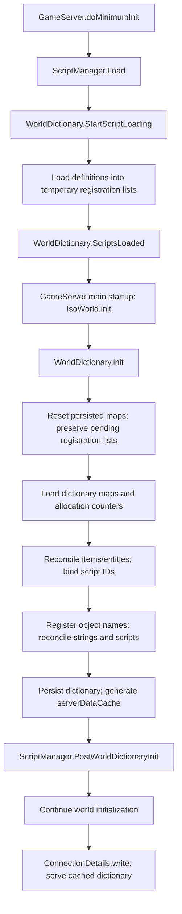

# World dictionary PostgreSQL integration map — 42.21.0

Status: source investigation only. No runtime patch, migration, or database operation is implemented by this document. The backend agent is implementing V6 using `player_rel` with revised table names. This map intentionally describes engine responsibilities without adopting the earlier proposal's SQL names or reconciling V6. All vanilla references are relative to this version's `decompiled/zombie` tree. Existing patched consumers and the current connector were checked separately.

## Main finding

The dictionary is collected during script loading, then loaded/reconciled/persisted once at world initialization. The normal gameplay getters are memory lookups, not file reads. The PostgreSQL boundary belongs around `WorldDictionary.init()`: hydrate persisted maps/counters, reconcile actual installed definitions, commit shared allocations and server-local state, and publish the client cache before world initialization proceeds. Do not send gameplay getters to JDBC.

Changing only `DictionaryData.load()` and `save()` would replace file I/O, but would leave four local allocation loops uncoordinated between servers. Conversely, removing `save()` entirely would remove generation of `serverDataCache`, which the native client handshake expects.

## Call flow and initialization barrier

Verified callers:

| Caller | Exact boundary | Implication |
| --- | --- | --- |
| [Patched GameServer](src/zombie/network/GameServer.java#L1490) | `doMinimumInit()` calls `ScriptManager.instance.Load()` | Pending definitions already exist before dictionary persistence is loaded. No SQL is necessary during each script's registration callback. |
| [Patched GameServer](src/zombie/network/GameServer.java#L793) | Calls `IsoWorld.instance.init()` during main startup, before the simulation loop | A bounded synchronous startup transaction is appropriate here. This is a different latency situation from synchronous login SELECTs on an already-running simulation. |
| [IsoWorld](decompiled/zombie/iso/IsoWorld.java#L2047) | `WorldDictionary.init()` immediately followed by `ScriptManager.instance.PostWorldDictionaryInit()` | Committed final IDs must be available before the post-dictionary callbacks execute. `GameEntityManager.Init()` and subsequent world loading follow this barrier. |
| [WorldConverter.softreset](decompiled/zombie/iso/WorldConverter.java#L280) | Also calls `WorldDictionary.init()` and then `PostWorldDictionaryInit()` | A second entry path. A dictionary adapter must handle soft-reset initialization, not assume the main IsoWorld call is the only caller. |
| [IsoWorld](decompiled/zombie/iso/IsoWorld.java#L2463) | Calls `WorldDictionary.onWorldLoaded()` | The callback is empty in this version. It is too late to perform authoritative initial ID allocation. |

`WorldDictionary.init()` throws `WorldDictionaryException` when initialization fails. The patched server catches an exception from `IsoWorld.init()`, logs termination and returns from startup. Preserve this stop-before-world-load behavior for authoritative database failures. Do not continue with fresh local allocations if PostgreSQL is unavailable.

## 1. Collection phase: pending definitions, not persistent allocation

| Class/method | State changed | Treatment in a PostgreSQL implementation |
| --- | --- | --- |
| [ScriptManager.Load](decompiled/zombie/scripting/ScriptManager.java#L1547) | Calls registration start before discovering/loading game and mod script files; calls `ScriptsLoaded()` after resolution | Preserve ordering and mod load precedence. No initial need to patch this large class. |
| [WorldDictionary.StartScriptLoading](decompiled/zombie/world/WorldDictionary.java#L71) | Opens `allowScriptItemLoading`; clears selected item/entity pending maps and each named register's load list | Keep memory-only collection. Do not accidentally replace it with clearing committed SQL identities. |
| [GameEntityScript.Load](decompiled/zombie/scripting/entity/GameEntityScript.java#L156) → `WorldDictionary.onLoadEntity()` | Reports non-item entity definitions and routes items to `onLoadItem()` | Existing producers can stay unchanged. |
| [WorldDictionary.onLoadItem / onLoadEntity](decompiled/zombie/world/WorldDictionary.java#L87) | Creates/reuses pending info records; captures module/name/full type, mod ownership, override order, vanilla history, obsolete state and runtime script pointers | These records are the current installed-definition input to reconciliation. They do not allocate native IDs. |
| [SpriteConfigScript.load](decompiled/zombie/scripting/entity/components/spriteconfig/SpriteConfigScript.java#L192), [SpriteOverlayConfigScript.load](decompiled/zombie/scripting/entity/components/spriteconfig/SpriteOverlayConfigScript.java#L62) | `ScriptsDictionary.registerScript(this)` dispatches into matching register's `loadList` | Preserve collection and the actual engine-generated version inputs. |
| [ScriptsDictionary.registerScript / ScriptRegister.register](decompiled/zombie/world/ScriptsDictionary.java#L76) | Whitelist-based register selection; pending record keyed by `getScriptObjectFullType()` | No DB allocation here. The declared ContextMenuConfigs register exists, but no explicit registration producer for it was found in the searched vanilla tree; support an empty register without inventing registrations. |
| [FluidFilterScript](decompiled/zombie/scripting/objects/FluidFilterScript.java#L120) | Registers its full type in `StringDictionary.Generic` | Preserve callback. |
| [WorldDictionary.collectStrings](decompiled/zombie/world/WorldDictionary.java#L193) | Temporarily reopens registration to collect XUI layout names into Generic | Happens inside dictionary init, after scripts have closed normal registration. Capture these names before database reconciliation/publication. |
| [StringRegister.register](decompiled/zombie/world/StringDictionary.java#L177) | Validates registration timing and native length rules; appends pending string by value | Keep memory-only, preserving exact string keys. |
| [WorldDictionary.collectObjectNames](decompiled/zombie/world/WorldDictionary.java#L172) | Collects distinct object names from `ErosionRegions` categories | Pending names must exist before object-ID allocation. |
| [WorldDictionary.ScriptsLoaded](decompiled/zombie/world/WorldDictionary.java#L79) | Closes normal registration | Late item/entity registrations warn and can throw in debug; script/string registration guards also reject invalid timing. A future SQL adapter must not silently enable live hot registration. |

`getItemLoadList()` and `getEntityLoadList()` select separate Main versus MP pending maps. The dedicated server uses MP. `GameServer.server` and `GameClient.client` must be respected; single-player uses Main and should retain its original file path when the server-only database feature is disabled.

Important distinction: `DictionaryData.reset()` and script/string `reset()` clear persisted lookup maps and counters. `StartScriptLoading()` / `onStartScriptLoading()` clear pending registration lists. They are deliberately different phases; a SQL hydrator invoked during init must not erase the definitions just collected by ScriptManager.

## 2. Hydration and filesystem operations

| Class/method | Current behavior | Integration decision |
| --- | --- | --- |
| [WorldDictionary.init](decompiled/zombie/world/WorldDictionary.java#L237) | Chooses server DictionaryData or DictionaryDataClient, resets persistent state, handles incoming client bytes, runs load/reconciliation/save with error handling | Primary coordinator for the database session and startup transaction. Branch only for configured dedicated-server authority; retain native client/single-player behavior. |
| [DictionaryData.load](decompiled/zombie/world/DictionaryData.java#L436) | Reads WorldDictionary.bin; missing file is accepted only for a new game; calls `loadFromByteBuffer()` | Replace file authority with a relational read and hydration in DB mode. Bootstrap permission comes from explicit namespace/save binding, not merely a missing local file. Never fall back to an empty local dictionary after a DB error. |
| [DictionaryData.loadFromByteBuffer](decompiled/zombie/world/DictionaryData.java#L462) | Loads counters, both directions of all core maps, then StringDictionary and ScriptsDictionary registers | This defines the state a relational hydrator must populate. Keep this decoder for native client packets and possible diagnostic fixtures; PostgreSQL need not manufacture bytes to call it. |
| [DictionaryInfo.load](decompiled/zombie/world/DictionaryInfo.java#L248) | Decodes item/entity metadata; does not restore a script object or an `isLoaded` flag | SQL hydration must rebuild info records and defer local script binding to reconciliation. Loading another server's `isLoaded=true` as authoritative local availability is incorrect. |
| [StringRegister.load](decompiled/zombie/world/StringDictionary.java#L305), [ScriptRegister.load](decompiled/zombie/world/ScriptsDictionary.java#L375) | Load counters and private bidirectional maps; loaded flags and script hashes are persisted | Need typed hydration/export bridges inside these classes; the fields and static register collections are private. Hydration must rebind actual scripts through the local load list. |
| [DictionaryData.backupCurrentDataSet](decompiled/zombie/world/DictionaryData.java#L364), `deleteBackupCurrentDataSet()` | Copy/delete a local .bak around startup | Bypass local-file authority work in DB mode; use database transaction/version history for recovery. Do not run the original file copy before the SQL branch. |
| [DictionaryData.createErrorBackups](decompiled/zombie/world/DictionaryData.java#L388) | Creates a WD_ERROR directory and copies file/log diagnostics | Retain optional diagnostics, but report selected namespace/view and failure stage. Copies of stale local .bin files must not be treated as the current DB dictionary. |
| [GameLoadingState](decompiled/zombie/gameStates/GameLoadingState.java#L257) | Sets `WorldDictionary.isNewGame` from the client/single-player loading path | This flag is not sufficient authority to select/create a shared PostgreSQL dictionary. Keep server namespace configuration separate. |

## 3. Authoritative mutations: allocation and installed-definition reconciliation

These are the four allocation sites that must be covered together:

| Owning method | Actual mutation | Required PostgreSQL coordination |
| --- | --- | --- |
| [DictionaryData.parseInfoLoadList](decompiled/zombie/world/DictionaryData.java#L246) | New non-obsolete item/entity gets `nextInfoId++`; inserts into ID/name maps. Existing records can be reinstated, change mod owner/modded flag, become obsolete/removed, and become loaded. | Items and entities share one counter. Use counters loaded under the namespace lock, or inject a database-resolved allocation result. Both method invocations in init must share the same allocation transaction. |
| [DictionaryData.parseObjectNameLoadList](decompiled/zombie/world/DictionaryData.java#L345) | New object name gets `mextObjectNameId++` and enters both maps | Same transaction/session as the other allocation domains; byte-sized limit. |
| [StringRegister.parseLoadList](decompiled/zombie/world/StringDictionary.java#L222) | Per-register `nextId++`, map insertions and loaded flags | Coordinate every named register independently within the same publication. |
| [ScriptRegister.parseLoadList](decompiled/zombie/world/ScriptsDictionary.java#L279) | Per-register `nextId++`; new script identities; binds local script objects; computes/updates `version`; sets loaded state | Coordinate every script register; persist the actual signed long returned by the engine hash logic. |

Related non-allocating mutations are equally important:

- [DictionaryData.parseCurrentInfoSet](decompiled/zombie/world/DictionaryData.java#L298) iterates stored item/entity records, marks missing ones removed, resolves definitions through ScriptManager, and writes the final registry ID into each live script using `setRegistry_id()`. This changes engine objects as well as dictionary metadata. Do not let a consumer retain an ID assigned before conflict resolution or transaction commit.
- Existing-info reconciliation updates a subset of fields. It does not automatically copy the complete pending override list/vanilla-history metadata onto every existing record. The future adapter must explicitly reconcile/export those fields according to the published V6 contract; loading SQL rows and assuming native parse copies every current-definition field is insufficient.
- Native script/string `parseLoadList()` sets false flags on pending load-list values, not every historical stored value in `namedMap` / `stringToIdMap`. Old `isLoaded` flags can otherwise survive. A shared database implementation must recompute per-server availability instead of publishing another server's old loaded state.
- [DictionaryDataClient.parseCurrentInfoSet](decompiled/zombie/world/DictionaryDataClient.java#L24) writes received IDs/mod ownership into client-local script definitions and sets local loaded flags. This is intentional client-side mutation with no PostgreSQL access.
- Native record `load()`/`copyFrom()`/`copy()` methods also assign fields while hydrating or building log snapshots. Those are not independent registration events and must not trigger new SQL allocations.

Core lookup-map changes were found in DictionaryData reset, binary hydration, reconciliation/allocation, and the client binder. No separate periodic dictionary update/save loop or gameplay-time core sprite dictionary allocator was found. Sprite maps/counter are restored by binary load and read by getters; absent sprite entries fall back to IsoSpriteManager.

## 4. Publication, native encoding and client synchronization

| Class/method | Current behavior | PostgreSQL-mode requirement |
| --- | --- | --- |
| [DictionaryData.save](decompiled/zombie/world/DictionaryData.java#L521) | Encodes all state, builds `serverDataCache` on a server, writes .tmp and copies to WorldDictionary.bin | Split these responsibilities: persist typed state in one transaction; independently generate the native client cache from final committed mappings. Do not discard cache creation when bypassing file writes. |
| [DictionaryData.saveToByteBuffer](decompiled/zombie/world/DictionaryData.java#L550) | Encodes format version, counters, compressed module/mod lists, info/object/sprite maps, strings and scripts | Preserve native encoder for the handshake. No SQL query should run while encoding one field. Rebuild cache whenever a new view is deliberately activated. |
| [DictionaryData.saveAsText](decompiled/zombie/world/DictionaryData.java#L603) | Writes human-readable Lua diagnostics | Optional diagnostic export from the selected view. A diagnostic file failure should be distinguished from failure to publish authoritative SQL data; no accidental mixed DB/file authority. |
| [WorldDictionaryLogger.saveLog](decompiled/zombie/world/logger/WorldDictionaryLogger.java#L41) | Writes log events to WorldDictionaryLog.lua; WorldDictionary resets logger afterward | Keep local logs if useful; add relational journal events from the transaction result. Do not make each logger callback allocate IDs or perform a separate transaction. |
| [ConnectionDetails.writeWorldDictionary](decompiled/zombie/network/ConnectionDetails.java#L163) | Calls `WorldDictionary.saveDataForClient()` as part of connection details | Keep existing caller and packet order. It must see a ready cache; it is not a place to fetch/reconcile a fresh database dictionary per login. |
| [WorldDictionary.saveDataForClient](decompiled/zombie/world/WorldDictionary.java#L214) | Sends cached native bytes (or encoder fallback) and the DICTIONARY_PACKET_END marker | Keep protocol and client consistency checks unchanged. Cache and runtime maps must represent the same committed view. |
| [ConnectToServerState.receiveWorldDictionary](decompiled/zombie/gameStates/ConnectToServerState.java#L163) | Calls `WorldDictionary.loadDataFromServer()`, enables ClientPlayerDB and triggers OnConnected | Keep vanilla client path. The client does not connect to PostgreSQL. |
| [WorldDictionary.loadDataFromServer](decompiled/zombie/world/WorldDictionary.java#L206) → client `init()` | Stores incoming bytes; later loads them with `loadFromByteBuffer()` and checks the packet marker | Preserve. DictionaryDataClient overrides filesystem operations to no-op; DB activation must never route this object through server hydration/publication. |
| [ScriptRegister.parseLoadListClient](decompiled/zombie/world/ScriptsDictionary.java#L316), [StringRegister.parseLoadListClient](decompiled/zombie/world/StringDictionary.java#L251) | Bind client definitions; verify advertised scripts/strings exist and script hashes match | Keep checks. The shared database must not fabricate script hashes or loaded flags to force acceptance. |

`Core.isNoSave()` currently gates dictionary load/save and therefore cache preparation as well as disk writes. Decide explicitly whether DB mode is disabled for no-save operation or still hydrates an authoritative view; do not accidentally create an empty runtime dictionary or miss the cache because a file-specific guard bypassed the database branch.

## 5. Readers that should remain memory-only

| Reader | Current use |
| --- | --- |
| [WorldDictionary getters](decompiled/zombie/world/WorldDictionary.java#L321) → DictionaryData getters | Item/entity IDs/types/mod ownership, object names and sprite lookups. Some getters return info records directly; treat identity fields as immutable after publication. |
| [InventoryItemFactory.CreateItem(short)](decompiled/zombie/inventory/InventoryItemFactory.java#L180) | Resolves dictionary ItemInfo, then its locally rebound script definition. |
| [Patched InventoryItem](src/zombie/inventory/InventoryItem.java#L1729) | Uses registry IDs for extra item types; native item loading goes through the factory. The relational player path also depends on actual installed definitions. |
| [Patched IsoObject](src/zombie/iso/IsoObject.java) | Reads/writes dictionary object-name and sprite-name references in object serialization. |
| [Patched IsoThumpable](src/zombie/iso/objects/IsoThumpable.java) | Resolves fuel item type/ID during save/load. |
| [ScriptsDictionary.ScriptRegister](decompiled/zombie/world/ScriptsDictionary.java#L168) | `saveScript`, `loadScript`, `get`, `getIdFor`, info lookup and registration predicates use in-memory maps. |
| [Patched SpriteConfig](src/zombie/entity/components/spriteconfig/SpriteConfig.java#L269), [SpriteOverlayConfig](decompiled/zombie/entity/components/spriteconfig/SpriteOverlayConfig.java#L144) | Native component serialization resolves script IDs through those registers. |
| [StringRegister](decompiled/zombie/world/StringDictionary.java#L114) | `saveString`/`loadString` use registered IDs, with the native literal-string fallback. |

No getter replacement is necessary to make PostgreSQL the persistence authority. Hydrate the right state before these consumers run and preserve native signatures. The underlying fields, especially register collections/private maps, need explicit internal adapter methods rather than reflection-based per-lookup SQL.

## 6. Connector boundary and recommended patch surface

The current [ApocBRPostgresConnector](src/zombie/savefile/ApocBRPostgresConnector.java#L128) already owns the shared Hikari pool. `borrowPlayerConnection()` and `borrowVehicleConnection()` return caller-owned leases with auto-commit false; `borrowServerConnection()` uses auto-commit true. Every lease currently sets schema to `public`. Pool initialization is lazy through `current()`; it does not require ServerPlayerDB to exist first.

Add a purpose-named `borrowDictionaryConnection()` using the same internal `borrowConnection(false)` path. A temporary use of the player lease would have the same JDBC mechanics, but a dedicated method states the startup ownership correctly. Do not use the auto-commit-true server lease for multi-step shared ID allocation. Fully qualify the eventual V6 `player_rel` table names; changing the pooled session's default schema is unnecessary and can affect other persistence callers.

Use a separate typed dictionary repository over that connection. The existing connector snapshot/mirror queue (`enqueue`/`process`/`savePlayerSnapshot`) writes networkplayer blobs and is not the dictionary transaction scheduler. Do not put startup dictionary publication in that best-effort queue or in the relational player backfill worker: the world must not proceed until its IDs are committed.

Suggested initial source footprint, subject to the actual V6 contract:

| Source | Reason to patch |
| --- | --- |
| `world/WorldDictionary.java` | Add server-only backend selection, wrap initialization in the authoritative session, coordinate rollback/failure and publish the committed view/cache. |
| `world/DictionaryData.java` | Add core typed hydration/export, cover info/object allocation and local metadata reconciliation, split client cache generation from file writes, handle backup/text paths in DB mode. |
| `world/ScriptsDictionary.java` including `ScriptRegister` | Add private-register hydration/export/allocator access; reconcile current hashes and per-server loaded state. |
| `world/StringDictionary.java` including `StringRegister` | Same for string registers/counters and loaded flags. |
| New helper(s) under `world/` | Engine-side DTOs/session adapter can access package/protected records; expose minimal bridges for private fields. SQL belongs in a separate repository, with no live engine objects on an I/O worker. |
| `savefile/ApocBRPostgresConnector.java` | Add the purpose-named caller-owned transactional lease hook. |

No initial need to patch ScriptManager, IsoWorld, ConnectionDetails, ConnectToServerState or every item/object serializer. Their existing calls already cross the dictionary coordinator. If a DictionaryData subclass is preferred for server-only storage selection, WorldDictionary still needs the selection/session boundary and script/string registers still need bridges; subclassing alone cannot access their private collections.

There are two viable allocation implementations. The simplest startup-only approach is to keep the native `nextId++` loops **inside one namespace-locked transaction**, after loading the latest committed catalog/counters and before committing all resulting changes. The lock must span load, all four allocation loops, binding and publication. Alternatively, pre-resolve all new IDs through a typed repository and have the parse methods consume those assigned IDs. In either case, a transaction started only at final save is too late: two servers could have already assigned the same ID differently.

Commit before allowing PostWorldDictionaryInit/world consumers or client handshakes to observe the result. If a transaction rolls back or is retried, discard/rebuild mutated maps, bindings and candidate cache; never keep provisional IDs bound to script objects. Do not hold a pool lease or namespace lock for the remainder of server uptime.

## 7. Lifecycle cases and next implementation checks

- Normal dedicated startup, fresh save using an existing template, and a restart with added/removed mods must converge through the same authoritative path.
- The separate soft-reset caller must retain correct initialization ordering and rollback behavior.
- `ScriptManager.ReloadScripts()` does not perform a full dictionary init/publication. It invokes reload callbacks, while normal registration guards are closed. It is not an existing live shared-dictionary update protocol. Initial support should publish at startup, with explicit future work for any supported hot reload.
- Repeated initialization must reset maps and leases without losing pending definition input or leaking a failed transaction. Pay attention to local loaded flags, mod overrides, script pointers and final script registry IDs.
- SQL failure during load, lock acquisition, allocation or commit must stop authoritative startup and must not emit a ready cache. Optional diagnostic file handling must not mask the database error or claim a rollback after data was already committed.
- Test concurrent startups against one dictionary, all native ID limits, absent mods on only one server, empty registers, script version changes, cache/map consistency and unmodified client handshake validation.
- Test native mode disabled, single-player, client and no-save branches separately. No blanket `GameServer.server || GameClient.client` JDBC condition.
- Reconcile actual V6 table names, publication semantics and source namespace/view provenance **after** this call-site map is reviewed. The earlier WORLD-DICTIONARY-SCHEMA proposal may differ from the backend agent's final migration.

Verification performed: searched direct initialization/registration/client transport callers across the complete target-version vanilla tree; traced mutations and persistence in the dictionary package; checked existing patched consumers, startup failure handling and connector lease semantics. No dictionary replacement sources currently exist under `42.21.0/src/zombie/world`. No Java changes, database access, deployment or runtime tests were performed. Documentation-only work does not require compilation.
