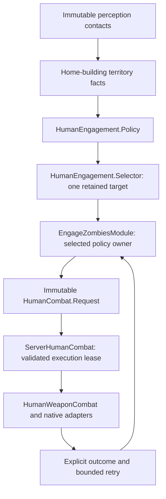

# Engagement policy and combat handoff scaffold

Profiles with `survival` now place [fight/flight and recovery](2026-10-21-npc-survival.md)
before engagement. GUARD_ZOMBIES itself remains the target eligibility policy;
survival owns whether ordinary pursuit may run and cancels it under pressure.

Implemented for server Build 42.21.0. This extends
[perception](2026-10-21-npc-perception.md) through a validated combat-system entry point.
The installed backend now implements initial Crowbar/Pistol combat, fixed test
inventory, approach and native packet/hit bridging. See [2026-10-21-npc-combat.md](2026-10-21-npc-combat.md)
for current capabilities, test settings and limits.

## Flow and owners



| Component | Owns |
| --- | --- |
| `brain/HumanEngagement.Policy` | Pure contact/condition/territory-to-choice rule. Initial `GUARD_ZOMBIES` doctrine only. |
| `brain/HumanEngagement.Selector` | One transient target identity and pure preview; immediate closer threats can override retention with distance hysteresis. |
| `brain/EngageZombiesModule` | Per-NPC selection, combat execution handle, cancellation and retry scheduling. Only selected-module updates actuate. |
| `brain/HumanTerritory` | Immutable observation of actor/contact membership in a defended area. No native building objects or faction ownership. |
| `ServerHumanTerritory` | Native adapter for the loaded origin building on the origin floor. Live containment checks for combat. |
| `brain/HumanCombat` | Typed template/request, port, execution and result contracts. No native dependencies or weapons implementation. |
| `ServerHumanCombat` | One active combat lease, live validations, execution IDs, bounded lifetime and native backend handoff. |
| `ServerHumanProfiles` | Code allowlist and fresh per-actor construction; `militia-patrol` composes engagement and existing roaming. |

The existing module scheduler still owns priority arbitration; lower numbers win.
There is no new actor subclass, per-role actuator or NPC-key conditional.

## Initial decision template

`GUARD_ZOMBIES` engages a currently observed zombie when the actor and the
contact are inside the home-building territory, the actor is not dead/downed/
immobile, and the sample is sufficiently fresh. It does not initiate attacks on
players. Exhaustion/fear/outnumbering/relations/weapon utility remain future
policy extensions. Weapon selection belongs behind the combat port, not here.

The selector chooses the nearest eligible contact when acquiring, then retains
that identity instead of switching every perception update. A visible eligible
challenger within 1.5 tiles overrides a target at least 0.25 tiles farther away,
or overrides WATCH/missing-target retention. Smaller distance changes and distant
challengers retain the target. Selection remains pure; the selected module cancels
the owned execution with TARGET_CHANGED before starting its replacement, without
a failure retry delay. Pending windup cannot commit a strike on the old target;
already committed damage is never rolled back. Lost visibility can
produce WATCH for up to `lostGraceMs`: the module cancels active combat while
remembering intent. WATCH does not authorize attacking last-known coordinates.
Expired grace, a confirmed missing contact, territory exit or physical veto
releases the target. Missing contacts in partial sensing can be held only while
the available territory/policy facts still permit it; missing facts fail closed.

Scheduler eligibility is a pure preview. It neither assigns a target, starts
combat nor mutates cooldowns. Selection and execution mutation happen only in
the selected module's `update`. Preemption/suspend/stop cancel once and release
the handle/target. Backoff survives scheduler interruption so an unsupported
backend cannot be retried at every tick. Resume reacquires from current sensing.

## Combat contract and safety boundary

`HumanActuator.combat()` supplies a `HumanCombat.Port`:

```java
HumanCombat.Execution execution = actuator.combat().begin(
    new HumanCombat.Request(targetIdentity, HumanCombat.Template.GUARD_BASIC), now);
HumanCombat.Result result = execution.update(now);
// On interruption:
execution.cancel(HumanCombat.Reason.PREEMPTED);
```

The initial template ID is an allowlisted placeholder for a future combat
configuration. It is not a weapon type or animation preset and does not currently
grant firearms, spawn inventory or choose arbitrary database executable code.

Results distinguish RUNNING, COMPLETED, REJECTED, FAILED, CANCELLED and
UNSUPPORTED, with typed reasons. An uninstalled/default port returns
UNSUPPORTED/NOT_IMPLEMENTED; production installs `ServerHumanWeaponBackend`.
COMPLETED can only come from an actual backend;
merely accepting an intent does not report that a zombie was killed.

`ServerHumanCombat` revalidates at start and before each backend update:

- Current canonical physical state permits execution.
- The sample exists, is not from the future, and is at most 500ms old.
- The sensor-local typed identity still resolves to a currently observed zombie,
  with matching active-world membership/native IDs, range and current LOS.
- Both native actor and target positions remain in the loaded home territory.

Perception PARTIAL does not block an otherwise valid observed target; it only
prevents assuming all other threats are absent. Cached native coordinates are
not authoritative: moving outside territory between samples is rejected before
backend progress. Unknown/recycled target handles cannot reach the backend.

One active lease is allowed per actor. Each accepted backend handoff gets a
monotonically increasing ID scoped to that presentation activation. Terminal
updates/cancels are idempotent. Leases expire after 60 seconds. Start/poll/cleanup
exceptions produce failures and release the service lease; future backends must
clean any partial acquisition before throwing from `begin`, and own cleanup of
their movement, aim, equipment and animation resources.

These are in-memory execution IDs, not a crash-durable combat journal. The
future attack commit still needs its own one-shot marker and revalidation of
weapon/ammo, melee arc/attack line, cooldown and damage authority. This wrapper
does not prove that a native packet creates a hit. Native actor references exist
only behind the port in the backend adapter, never inside observations/policies.

## Profile and database configuration

The built-in `militia-patrol` revision 1 uses `behaviorId=modules`:

| Module | Priority | Cycle | Parameters |
| --- | --- | --- | --- |
| `engage-zombies` | 100 | 100ms | maxSampleAgeMs=500, lostGraceMs=1000, retryMs=2000 |
| `roam` | 1000 | 100ms | Existing roamPauseMs=3000 default |

It has radius 8, 100ms perception, LOS required, no greetings, no announcements,
no dialogue and no trading. Existing roaming still requests WALK. Combat approach
can request RUN/WALK separately, resolved by existing physical conditions. The
initial combat inventory is a test adapter, not a complete survivor inventory.

Timing fields use the existing millisecond parameter schema. Validation bounds:
max sample age 0..500ms; lost grace 0..3000ms; retry 100..60000ms. Unknown keys
are rejected in code. Native validation keeps its 500ms ceiling independently
of a module's stricter setting. Custom doctrine can be injected through the
policy interface; execution mechanics need not inspect a profile ID.

Manager migration `V21__Seed_Militia_Engagement_Profile.sql` seeds the module
catalogue, timing metadata and immutable published profile/bindings. It adds
explicit existing-table privileges for `pz_server_01`, creates no new tables or
sequences, and never changes existing guide profiles. Apply code and migration
together before selecting the new profile through database configuration.

No second actor is automatically created. Use the existing creation flow with a
new key/username, `profileId=militia-patrol`, and an origin inside the intended
loaded building. Contacts, territory membership, target locks, executions,
retry deadlines and presets remain transient; routine physical checkpoints
remain at their existing 30-second default. No live database was modified.

DEBUG logs emit `combat begin` and `combat end` with logical actor key,
execution ID, target/template and outcome. Existing ERROR default suppresses
these messages. The installed backend also emits one `combat commit` diagnostic
per strike, independent of viewer count.

## Verification and next increment

`tools/test_human_engagement.py` exercises production pure policy/selector,
module arbitration, target retention, interruption, retries, explicit results,
territory facts, native target resolution/reuse, freshness, physical vetoes,
single-lease ownership, timeout and backend exceptions. Existing NPC fixtures
cover behavior, movement, interaction, state and lifecycle compatibility.
The isolated PostgreSQL fixture hydrates the seeded profile; manager Flyway
tests use separate migration/engine roles and verify publication/permissions.
Game-JAR dry compilation checks 42.21.0 native signatures. No deployment or live
combat testing is implied by these checks.

Initial destination planning, equipment/aim, melee and firearm commit paths are
now implemented in [2026-10-21-npc-combat.md](2026-10-21-npc-combat.md). Detailed A-life
evidence and the broader component roadmap are in the
[combat implementation map](../reports/2026-10-21-npc-alife-combat-implementation-map.md).
