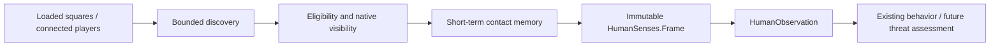

# NPC perception and short-term contact memory

Implemented for the server-owned IsoPlayer engine on Build 42.21.0. Perception
owns facts about observed entities; it does not choose enemies or execute combat.

`HumanObservation.awareness` additionally publishes local zombie crowd facts
without requiring line of sight. It shares the existing discovery/body budgets,
membership validation, floor and radius restrictions. The visual `senses` frame
and `resolveZombie` still gate attacks through line of sight. Awareness can detect
new or moving zombies behind furniture/walls; it cannot authorize shooting through
them. Retained awareness distances follow the observer's current position.

## Ownership and flow

| Owner | Responsibility |
| --- | --- |
| `ServerHumanPerception` | Per-actor simulation-thread adapter: native reads, discovery cursors, LOS, native identity bindings and sampling. |
| `brain/HumanContactMemory` | Bounded last-seen memory with explicit time/invalidations; no native dependencies, IO or decisions. |
| `brain/HumanSenses` | Immutable identities, sightings, contacts, coverage, work counts and published frames. |
| `ServerHuman` | Owns the sensor for the active presentation lifetime and clears it on disposal. |
| `ServerHumanFactory` | Samples active actors on the existing update loop, including while dialogue/trade owns behavior. |
| `ServerHumanActuator` | Delegates observation; preserves connected-player `visitors()` and immediate player-facing validation. |

The discovery/visibility/retention separation is inspired by the installed
A-life perception machinery described in the
[militia design investigation](../reports/2026-10-21-npc-militia-patrol-and-threat-perception.md).
Our implementation queries loaded squares directly instead of taking a complete
world-zombie snapshot. It uses our detached actor and native 42.21.0 LOS rules.

Visual sensing uses the profile's existing `perceptionRadius` and `requireLos`.
Survival-enabled profiles extend obstacle-independent awareness to at least
`min(24, retreatDistance + crowdRadius)` tiles (16 with default settings), without
extending visual attack authorization. Their discovery interval is capped at
100ms; other profiles retain `perceptionIntervalMs`. No migration is required.
Active profiles retain their existing
revision semantics. Contact memory remains separate from durable physical state.

## Discovery and work bounds

The origin is the actor's current position and floor. Tile offsets are prepared
once per actor, ordered from near to far. Discovery has two independent cursors:
the surrounding 5x5 squares receive a close-contact allowance (or the whole
configured area for smaller radii); the remaining
offsets receive a rotating outer allowance. Dense-square entity iteration resumes
at its previous body position instead of repeatedly inspecting its first entries.
These are best-effort samples of changing world lists, not an atomic world view.

Per sample, per actor:

| Work | Maximum |
| --- | --- |
| Connected-player list entries inspected | 128, with rotating cursor |
| Tile visits | 128: up to 25 close, remainder outer |
| Square moving-object entries inspected | 256: 64 close, 192 outer |
| Zombie candidates kept for visibility | 48 nearest; equal-distance ties rotate |
| Player visibility checks | 32, rotating |
| Zombie visibility checks | 16: nearest-contact reservation plus rotation |
| Contacts retained | 128 |
| Memory after leaving relevance radius | 3 real seconds since last relevant sample or sighting |

Known, valid in-range zombie contacts are also offered for visibility refresh
without waiting for discovery to revisit their tile. This avoids unnecessary
visible/remembered oscillation during an outer sweep. Refresh validation is
bounded by the retained-contact capacity. Nearest shortlisting can still omit
farther targets in a crowd; this is explicitly partial coverage, not proof that
the remaining area is safe. A single actor's budgets are not a global server ray
budget. Large populations may need staggered sampling and shared scheduling;
this change makes no measured server-performance claim.

No scan enumerates `IsoCell.getZombieList()`. It uses native
`IsoGridSquare.getMovingObjects()` and our existing active-world membership set.
The animal perception grid's fixed-radius semantics are unchanged.

## Visibility and eligibility

Players retain the existing requirements: connected authoritative player-map
entry, alive, visible, same floor, inside radius and optional LOS. Only currently
observed players feed the legacy `HumanObservation.visitors()` list, ordered by
distance. Remembered players cannot trigger greetings as if still visible.

Zombie candidates must be alive with positive health, finite coordinates,
on the current floor, in a loaded current square and registered in the active
world set. Discovery ignores stale square-list entries. Grapple-only reanimated
corpses are excluded. There is no assumption that a zombie is hostile, reachable
or attacking just because it is observed.

Known binding death, zero health, removal and identity reuse are revalidated on
each heartbeat, even before the next discovery sample. Both awareness and visual
memory are invalidated together; invalidation preserves the original sample time
and does not invent fresh coverage. DEBUG invalidation logs include identity,
native dead flag and health. Memory is transient and starts empty on activation;
already dead indexed zombies are excluded from fresh discovery after a restart.

With `requireLos=true`, the adapter checks the loaded path and asks native
`LosUtil.lineClear(..., false)`. Walls and closed doors block sight; native clear
window/open-door results permit sight. The explicit loaded-path check is needed
because vanilla LOS can skip missing squares. With `requireLos=false`, the
profile deliberately opts out of the LOS check, matching its existing meaning.
There is no FOV, lighting, hearing, target-of-target or attack-line simulation in
this increment. Sight through a window never establishes melee reachability.

42.21.0 source authority: `decompiled/zombie/iso/LosUtil.java`,
`IsoGridSquare.java`, `IsoMovingObject.java`, `characters/IsoZombie.java` and
`VirtualZombieManager.java`. Existing patched `ServerMovingObjectSet` supplies
the membership token; no vanilla source file was replaced for this capability.

## Contact identity and retention

`HumanSenses.Identity` contains entity kind, native online/instance IDs and a
sensor-local generation. Player and zombie identities occupy different kinds;
they must not be passed interchangeably to the player-only facing capability.

The adapter keeps bounded native bindings outside observations. For zombies it
also stamps `ServerMovingObjectSet.member(body)`. Removing and reinserting a
pooled object creates a different membership token even when its Java object,
`getID()` and online ID are identical. The prior contact is invalidated and the
new observation receives another generation. Player slot reuse resolves through
the authoritative player map and native object binding. These identities are
local sensor handles, not network credentials or durable entity IDs.

A contact carries last-observed position/distance, first-seen time, last-seen
time and `visible`. Each new sample marks unchecked/occluded contacts remembered;
visible sightings refresh them. Hidden movement never updates their last-known
position. Dead, removed, unloaded or otherwise invalid bound entities are removed
immediately on the next heartbeat. Valid living bindings inside the local
awareness radius remain remembered even when LOS or a sampling budget omits
them. Relevance refreshes a private retention timestamp, never the visual
position, last-seen time or visible flag. After leaving that radius, a contact
expires three real seconds after its last relevant sample/sighting. A fresh
sighting is applied before eviction, preserving encounter first-seen time.
The capacity remains 128: visible and recently seen contacts take precedence
under pressure. Disposal/reactivation clears all activation-local memory.
`resolveZombie` still requires current visual contact and native revalidation;
remembered nearby targets cannot authorize attacks through a wall.
`IsoZombieGiblets` are neither living contacts nor corpse-task candidates.

Cached frames keep their actual `sampledAtNanos`; `HumanObservation.nowNanos`
remains the current decision time, and its physical-state snapshot remains fresh.
A cached visible flag means visible **at that sample**, not guaranteed visible
at the current tick. Consumers must inspect age and revalidate before action.

Coverage is separate for players and zombies:

- `COMPLETE`: the relevant discovery and visibility work fit this sample.
- `PARTIAL`: spatial/list sweep, missing discovered squares, shortlist or visibility
  limits prevent complete coverage. The default eight-tile scan spans several
  samples, so it normally reports partial spatial coverage.
- `UNAVAILABLE`: the sensor origin is not loaded; zombie coverage is also
  unavailable if the expected active-world membership index is absent.

`contactsTruncated` reports shortlist or retention truncation. `Work` reports
actual discovery and visibility-check counts. Complete, empty samples differ
from partial/unavailable samples; neither incomplete state proves "no threats."
Retained contacts are sensor memory, not a selected combat target or hostility.

## Consumers, lifecycle and diagnostics

Brains that request perception receive `HumanObservation.senses()`. Existing
two-, three- and four-argument observation constructors remain compatible with
an explicit unsampled empty frame. Modules that do not request perception still
receive their usual minimal observation; sampling itself is independent of that
choice. `ServerHumanFactory.perception(key)` exposes the latest immutable frame
on the simulation thread without triggering a scan. Inactive keys return null.

Dialogue/trade continue to suspend decisions exactly as before, while the
sensor keeps updating. No new interaction interruption or threat response is
implemented. Disposal clears contacts and native bindings; reactivation starts
fresh. No pending work, contact handles, clocks or memory enter PostgreSQL.

With `-Dapocbr.npc.logLevel=DEBUG`, contact transitions emit `VISIBLE`,
`REMEMBERED` and `FORGOTTEN` messages. Unchanged visible refreshes do not log.
The existing default `ERROR` suppresses these diagnostics before diff formatting.
Current debug identity output is a per-sensor diagnostic, not an attack token.

## Verification

`tools/test_human_perception.py` executes the production adapter, memory and
factory against small engine stubs. It covers immutable/cached frames, actual
sample time, retention/expiry, player compatibility, walls/doors/windows, unloaded
paths, invalidation, same-object/same-ID membership reuse, independent actors,
crowded-tile progression and bounded work, and sensing during exclusive dialogue.
Existing lifecycle, profile, brain, sequence, roaming, movement, state, dialogue
and trade fixtures check compatibility. The target game-JAR dry compile verifies
native method signatures. Dedicated-server testing must still confirm LOS around
actual map geometry, real zombie lifecycle transitions, and debug contacts with
one and two clients. No runtime deployment is part of this change.
