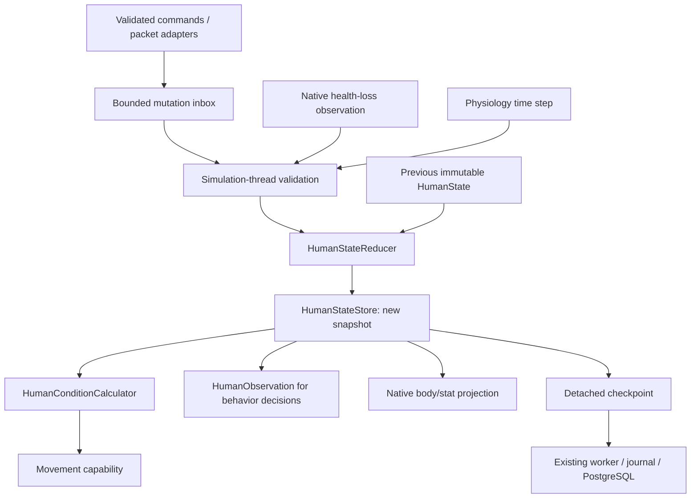

# NPC state store, reducers and condition projections

Implemented for server Build 42.21.0. Requires manager game-runtime migration
`V20__Persist_Npc_Physical_State.sql` before enabling this engine against an
existing PostgreSQL NPC store. No live migration or deployment was performed.

## Pattern and ownership

This is a single-writer state store with pure reducers and read-only projections.
The transition function is `nextState = reduce(previousState, mutation)`. Reducers
validate typed values, preserve old snapshots, apply invariants and advance the
state revision only when values change. They perform no world access, IO, clock
reads or random rolls. Adapters own those effects and pass explicit inputs.
This follows the [pure reducer pattern](https://redux.js.org/usage/structuring-reducers/prerequisite-concepts).

The bounded command inbox uses an actor-style single-writer approach, but does not
create an actor thread per NPC. The existing server simulation thread owns all
state writes. Persistence remains snapshot-based through the existing journal;
there is no append-only gameplay event history or event-replay reconstruction.
[Event sourcing](https://learn.microsoft.com/en-us/azure/architecture/patterns/event-sourcing)
would require that additional durable event-history contract.



| Component | Responsibility |
| --- | --- |
| `state/HumanState` | Immutable versioned physical/needs data; normalized fractions and injury flags. |
| `state/HumanMutation` | Allowlisted typed commands: Damage, Heal, Adjust, Treat, Mobility, Kill and Advance. |
| `state/HumanStateReducer` | Deterministic state transition and invariant enforcement. |
| `state/HumanStateStore` | Simulation-thread ownership, optimistic revision validation, immutable published snapshot. |
| `state/HumanConditionCalculator` | Read-only movement projection from canonical state plus environment/effect inputs. |
| `HumanLifecycle` | Logical identity/lifecycle and lifetime of the state store, including dormancy. |
| `ServerHumanFactory` | Activation validation, command inbox, per-tick ordering and durable checkpoint capture. |
| `ServerHumanPhysiology` | Native health-loss ingestion, explicit bleeding/endurance time steps, native body/stat projection. |
| `ApocBRNpcStore` | Hydration and atomic positional/lifecycle/physical checkpoints through the existing worker. |

Brains read `HumanObservation.state()`, including when they do not require visitor
perception. Cached visitor observations receive the latest own-state snapshot;
the perception sampling interval does not delay physical state visibility.
Decisions may propose actions or trusted mutations; they do not assign vital
fields or send SQL. The existing activity controller and outer lifecycle still
own their respective transitions. The physical reducer does not replace action
execution state, profile configuration, inventory ownership or relation policy.

## Mutation diagnostics

`HumanLog` supplies a shared NPC diagnostic threshold through the JVM system
property `apocbr.npc.logLevel`. The default is `ERROR`; supported levels are
`DEBUG`, `INFO`, `WARN`, `ERROR` and `OFF` (case-insensitive). Invalid values fall
back to `ERROR`. Configure it before startup; changing it requires a JVM restart.
Existing direct `DebugLog` lifecycle/service messages retain their own behavior.

For local testing, add this JVM argument before the server main class:

```text
-Dapocbr.npc.logLevel=DEBUG
```

`ServerHumanFactory` logs once after each changed checkpoint is successfully
queued for persistence. Individual reducer mutations never emit diagnostic
lines. The comparison uses the previous captured checkpoint, aggregating the
net changes to health, needs, injuries, mobility, position and lifecycle over
that interval. Values that change and return to their previous value before
capture do not appear as property differences. Both checkpoint and physical
state revisions identify the captured snapshots. Initial checkpoints show the
initial physical snapshot; unchanged checkpoints stay silent.

```text
[ApocBR][NPC][DEBUG] checkpoint queued key=guide; checkpointRevision=10 -> 11; stateRevision=130 -> 165; endurance=1.0 -> 0.99120605
```

These lines confirm capture/queueing, not journal durability or a PostgreSQL
commit. Routine checkpoints run every **30 seconds** by default through
`apocbr.npc.persistence.checkpointMs` (1000..60000ms). Lifecycle transitions still
checkpoint immediately. With persistence disabled there are no checkpoint
logs. Physical simulation and in-memory state mutations retain their existing
cadence. At the default `ERROR`, diagnostics are disabled before diff/message
construction. Messages use the existing native `DebugLog.log` server log
destination. They are diagnostics, not a durable audit trail.

Walking drains `.25/140` normalized endurance per simulated second (about 0.18
percentage points); idle recovers `9/140`, so roaming pauses can quickly restore
full endurance. Logging introduces no extra progression.
`tools/test_human_state.py` checks silence between checkpoints, one line per
queued checkpoint, unchanged checkpoint suppression, aggregated property output
and startup configuration. See [persistence and recovery limits](2026-10-20-npc-persistence.md).

## Initial tracked state

Every value below is durable. The names describe normalized logical NPC state,
not arbitrary native animation variables or a complete serialized player save.

| Slice | Values |
| --- | --- |
| Vitals/needs | Health, endurance, hunger, thirst, fatigue, pain, cold, fear, sickness, dirtiness, infection. All 0..1. |
| Injuries | Signed leg impairment -1..1, arm impairment 0..1, health-fraction bleeding rate per simulated second 0..1. |
| Mobility | Immobile and downed flags. |
| Versioning | Physical codec version 1 and monotonically increasing reducer state revision. |

Initial actors have health/endurance 1 and all needs/injuries zero. Death is
terminal: ordinary Heal/Adjust/Treat commands do not revive zero-health state.
Damage commits health, pain and coarse injury effects together; treatment reduces
impairment/bleeding, and Mobility explicitly controls immobile/downed status.
Needs use bounded adjustments; supplying NaN/infinity, invalid fractions, rates
or time steps fails before changing state. No-op mutations preserve revision.

This foundation tracks coarse physical effects, not individual native body-part
wound descriptors. Arm injury, fear, infection, sickness and dirtiness are ready
for future consumers but do not independently install combat/medical behaviors.
Bleeding is ongoing health loss; it is not automatically the terminal bleed-out
sequence used by A-life. Zero health drives the existing terminal logical death
and presentation removal path; corpse/loot/combat replication remains separate.

## Simulation and native integration

For each active actor, factory processing samples new native health loss, applies
a physiology step, derives movement conditions, then evaluates behavior. Death
is handled before autonomous actions. State updates also run during dialogue or
trade; dormant/dead actors receive no physiology ticks.

Elapsed physiology time is capped at 150 ms, using the same simulation cadence
as movement. No offline progression or long-stall catch-up is performed. Default
endurance rates normalize the inspected A-life values against 140: walking drains
0.25/140 per second, running 0.4/140, sprinting 1/140, idle recovers 9/140.
An active bleeding rate applies to health each step. Hunger, thirst and fatigue
are tracked and mutable, but their automatic drift rates are zero in this baseline.
Eating/drinking/rest and environment policies must submit explicit mutations;
the engine does not invent survival timing or secretly kill the lobby guide.

Native `IsoPlayer.getHealth()` and `BodyDamage.getOverallBodyHealth()/100` supply
new health-loss observations relative to the last projection. Loss enters the
same reducer. The bridge then writes canonical health back to both native scales,
and projects native ENDURANCE/HUNGER/THIRST/FATIGUE, PAIN/PANIC, SICKNESS and
ZOMBIE_INFECTION using their verified native units. Pain, panic and infection
use 0..100 on the native side. Existing god-mode/actor-detachment protections
are retained. Native resets/regeneration do not silently heal canonical state;
validated healing must use a Heal mutation.

This is one authority, with native values as an observation/projection boundary.
It is not two independently updated health stores. It does not run the full
native player update or import arbitrary native stat writes as authoritative
needs changes. Future native wound/healing/consumption adapters must translate
validated outcomes into commands rather than overwrite reducer state.

The condition calculator supplies health, signed leg injury, mobility and
effective endurance (`min(endurance, 1-fatigue)`). Cold contributes a bounded
movement scale. Raw environment and effect inputs remain separate from derived
conditions, preventing cold factors from multiplying again on every tick.
Movement's animation flags/WalkInjury are outputs, never health inputs.

## Command ingress, identity and acknowledgements

Trusted simulation-thread adapters call:

```java
factory.mutate(npcKey, activation, expectedStateRevision,
    new HumanMutation.Damage(0.1F, -0.4F, 0, 0));
```

Off-thread producers call `submitMutation(...)`, which accepts detached values
into a 1024-entry inbox. The factory drains at most 128 entries per simulation
step. A full/unavailable inbox returns an explicit status; it never grows without
bound. Do not block the simulation thread waiting for a submitted future or
attach blocking synchronous completion callbacks.

Results distinguish APPLIED, NO_CHANGE, STALE_REVISION, STALE_ACTIVATION,
INACTIVE, UNAVAILABLE and QUEUE_FULL. Activation is the logical actor's activation
count, not its native online ID. Stale/repeated commands with the same expected
revision cannot apply twice. Concurrent commands based on the same revision
conflict; callers must revalidate intent before resubmitting. Never blindly
rebase a possibly applied Damage/Heal command onto a newer revision.

The public API is a trusted internal boundary, not a remotely callable endpoint.
Packet adapters must first validate connection ownership, target, range,
weapon/cooldown and payload rules as appropriate. Existing incoming hit packets
are not automatically redirected to NPCs by this feature. There is no new RCON,
Lua, HTTP or client command that permits arbitrary damage/stat changes.

APPLIED acknowledges an in-memory transition. It is not a database fsync receipt
or exactly-once gameplay guarantee across crashes. Uncheckpointed state can be
lost under the existing checkpoint window. The inbox/futures are transient;
durable inbound transactions would need a separate inbox/receipt design.

## Persistence and migration

`V20__Persist_Npc_Physical_State.sql` extends `npc_engine.runtime_state` with
typed normalized physical/need columns, `physical_version` and `state_revision`.
Existing actors receive healthy defaults; existing DEAD rows receive zero health.
Published profiles and identity/configuration rows are not changed.

The enclosing checkpoint still owns `epoch` and `mutation_revision`; those are
distinct from the reducer's `state_revision`. Physical changes participate in
checkpoint equality/coalescing. They are written in the same UPSERT/transaction
as position/lifecycle and are subject to the same scope epoch and stale-write
fences. Hydration reconstructs validated immutable state on the worker, then
the simulation thread restores it before activation. Missing migration or invalid
physical data fails loading rather than silently resetting live NPC state.

Dormancy disposes the actor but retains its logical state store. Activation binds
the replacement actor to that store. Process restart uses the latest persisted
snapshot. No native IDs, monotonic effect deadlines, open interactions, futures
or Java object references are persisted. Bodies/stats are hydrated from logical
state; this does not create player save/account records.

Apply V20 as the existing game-runtime migration owner (`apocalipsebr`), then
deploy the updated 42.21.0 server patch. V20 explicitly grants schema usage and
runtime table SELECT/INSERT/UPDATE/DELETE to `pz_server_01`; no new sequences,
credentials, connection pools or superuser grants are introduced. No additional
activation flag is required beyond existing NPC persistence configuration.

## A-life source findings

Installed source root: Workshop 3803984183, ProjectALifeNPCs,
`42.20/media/lua/`. These findings are specific to that source snapshot.

| Source | Bookkeeping observed |
| --- | --- |
| `server/ProjectALife/Core/ALifeActorRegistry.lua:510`, `:541`, `:566` | Record copies, expected revisions, durable updates and transient updates; generation protects shell replacement. |
| `server/ProjectALife/Shells/ALifeShellState.lua:249` | Versioned shell capture includes health/max health, weapons, marked cargo and ammunition state. |
| `server/ProjectALife/Combat/ALifeHealth.lua:184`, `:237`, `:287` | Wound records, leg/arm/bleeding effects, injury persistence, damage/treatment revisions and timed downed/bleed-out/healing behavior. |
| `server/ProjectALife/Movement/ALifeEndurance.lua:42`, `:184` | Per-UID/generation endurance service, shell projection, dirty memory snapshots, fitness/activity drain and recovery. |
| `shared/ProjectALife/Visitors/ALifeVisitorSchema.lua:43` | Visitor needs: hunger, thirst, cold, fear, fatigue, dirty, sick and pain, bounded 0..5. |
| `shared/ProjectALife/Visitors/ALifeVisitorInstance.lua:82`, `:345` | Visitor need access and updates through actor-registry mutation paths. |

A-life is not one universal native-player metabolism implementation: visitor
needs and combat/shell physical state have different producers and representations.
Our initial normalized model makes those inputs explicit and centralizes mutation;
it does not assume every source NPC has the same hunger/thirst simulation.

## Verification

- `tools/test_human_state.py`: 74 assertions covering immutable/deterministic
  reduction, invariants, duplicate/stale commands, single-writer enforcement,
  condition projection, native health import/projection, behavior visibility,
  dormancy/reactivation, bounded inbox and terminal death.
- Existing movement, modifier, brain, sequence, profile, lifecycle, dialogue,
  trading and module runtime fixtures passed with the centralized state binding.
- `tools/test_npc_persistence.py --manager-test`: 53 real PostgreSQL/JDBC/worker
  assertions including nondefault physical hydration, relational need values,
  stale write rejection, coalescing and epoch fencing. The deliberate session-loss
  test logs SQLSTATE 08006 before reconnecting successfully.
- Maven ran `NpcPhysicalStateMigrationTest` and `NpcTradePolicyMigrationTest`:
  9 tests, zero failures, against disposable PostgreSQL 16 and distinct migration/
  engine roles. V20 tests check legacy backfill, grants, invalid values and Flyway
  revalidation/no-op repeat migration.
- The full 202-source server patch compiled against the real game JAR using
  `42.21.0/patchApocalipseBr.ps1 -DryRun`. No live deployment or database writes.

Dedicated-server two-client validation still needs native damage integration,
condition-driven animations, late viewer state and interruption/death presentation.
Future combat must establish packet target resolution and zombie ownership;
this state foundation does not itself enable damage delivery from those packets.
