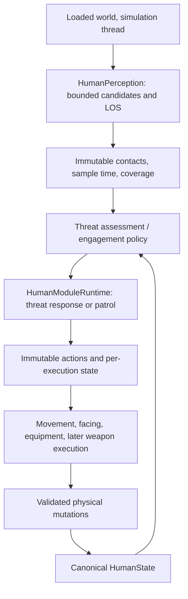

# Militia patrol, zombie perception and combat design

Implementation follow-up: shared candidate discovery, native visibility and
short-term contact retention are now implemented in
[NPC-PERCEPTION.md](../NPC-PERCEPTION.md). The current-state table below records
the investigation before that extraction. Militia policy and combat remain
subsequent implementation steps.

Investigated 2026-10-21 for our server-owned IsoPlayer engine on Build 42.21.0.
This is a design report; no militia actor, combat implementation or live database
configuration is created by this document.

## Recommended first implementation

Create a second logical actor using a new `militia-patrol` **data profile** on
the existing `modules` behavior. Compose reusable threat-response and patrol
modules through `HumanModuleRuntime`. A new monolithic `MilitiaBrain`, an
IsoPlayer subclass and militia checks inside movement are unnecessary.

First prove two things independently: the new actor can patrol at a requested
RUN pace, and shared perception can report a nearby visible zombie and interrupt
patrol. Initially its response should be stop/watch, with no attacks. Once those
work, implement a deliberate approach/retreat destination planner and one melee
attack against one zombie. Firearms and reciprocal zombie damage follow as
separate milestones. A running patrol plus threat detection is a useful test
actor, but is not yet a functioning combat guard.

The eventual guard policy should normally walk its patrol, run to a response
point when appropriate, engage zombies inside its defended area, and disengage
when condition or numbers demand it. Keep these choices independent of sensing
and physical movement. The first test profile can explicitly request RUN for
patrol segments so validation does not depend on combat being available.

## What exists in our engine

Source paths here are relative to `42.21.0/src/zombie/apocalipse/humans/`.

| Component | Verified behavior | Consequence |
| --- | --- | --- |
| `ServerHumanProfiles` | Registers `greet` and `roam` modules, modular guide/greeter profiles, legacy guide and idle factories. | Register new reusable modules and compose another profile. Do not clone the greeting brain. |
| `brain/HumanModuleRuntime` | Sorts ascending priority then module ID; checks higher-priority eligible modules, interrupts the previous winner, updates one winner. Per-module cycles are supported. | Lower numbers mean higher priority. Threat response can preempt patrol using existing cancellation. |
| `brain/HumanModule` | Eligibility is a pure query; only selected-module update may actuate. | Do not turn sensing, timers or state mutation into side effects of `eligible()`. |
| `ServerHumanActuator.observe` | Samples connected, eligible player visitors within profile radius, same floor and optional LOS; caches by profile interval. | There are no zombie observations yet. Extract a shared sensing adapter instead of growing role-specific scans. |
| `brain/HumanObservation` | Immutable player visitors, `canRoam`, own physical state and current time. | Add typed zombie contacts and the sample's actual time/completeness. Never pass live zombies into modules. |
| `brain/HumanActivityController` | Autonomous perception stops during dialogue/trade; exclusive modes face the visitor. | Combat-capable interaction needs a separate threat-interruption policy. First militia profile should disable dialogue and trade. |
| `ServerHumanRoaming` | Selects bounded cardinal routes within the origin building and floor. `start()` selects WALK through the movement overload. | Reuse its route selection; expose explicit pace through the action/actuator path. |
| `ServerHumanMovement` | Accepts WALK/RUN/SPRINT requests, resolves conditions, integrates route and publishes consistent gait/speed. | Running mechanics exist, but no shipped behavior requests RUN. Requesting RUN still permits condition-driven downgrade. |
| `ServerHumanActuator.observe` / `RoamModule` | `canRoam` requires a relevant viewer and available indoor roaming. | Existing patrol is not an offscreen world simulation; choose a loaded building and test with a nearby client. |
| `state/*`, `ServerHumanPhysiology` | Canonical physical state, endurance progression, native projection and movement restrictions. | Threat/combat producers must dispatch existing typed mutations rather than assigning stats. |

The existing `face(Identity)` also resolves **players only**. Watching a zombie
requires a generic look-at-point or typed-target capability; reusing a zombie's
numeric ID as a player visitor ID would be incorrect.

## Shared perception before profile decisions

Proposed names below describe new contracts, not existing classes.

Perception answers which entities are actually observed. Threat assessment adds
distance/contact urgency, direction of approach, current target and territory
membership when these are known. Engagement policy decides watch, defend,
commit or disengage. Seeing a zombie outside the patrol building must not
automatically grant permission to leave the building or attack it.

Suggested zombie contact fields: typed identity, x/y/z, squared distance,
observation time, visible/contact classification, and target information only
when verified. Include `sampledAtNanos`, contact-list truncation and sensing
coverage/availability separately from the decision tick's `nowNanos`. Our cached
visitor observations currently replace the outer time with the current tick;
that would obscure the age of cached threat positions.

Distinguish **no threat observed in a completed sample** from **sample unavailable
or budget exhausted**. The latter must not instantly clear an engagement. Keep
a short transient last-seen record and release hysteresis in the threat policy;
invalidate it on death, unload, activation change and expired memory. Reacquiring
a target needs a server-validated identity. Zombie online IDs can be reused and
objects can be pooled: choose and verify an incarnation token at the world
adapter boundary, rather than assuming a numeric ID or Java object is permanent.
Revalidate live membership and identity again when committing an attack.

Candidate discovery must be shared and bounded. For the first indoor actor,
inspect nearby loaded square membership with budgets for tiles, entities and
LOS rays, rotating unfinished work fairly. A small nearest shortlist is useful,
but truncating the result **after** scanning every world zombie does not bound
the scan. Reserve close-contact checks so a crowded distant shortlist cannot
hide a zombie next to the NPC. Stagger actor sample times as counts grow.

Native `IsoGridSquare.getMovingObjects()` and `IsoCell.getZombieList()` exist in
42.21.0. Our `ServerMovingObjectIndex.queryPerceptionTargets()` is backed by an
animal-specific grid with a fixed ten-tile zombie query and unrestricted human
candidates; it is not already a configurable NPC-radius query. Generalize it
with compatibility tests, or introduce an appropriate shared query port. Do not
silently use it for a profile whose radius exceeds ten tiles.

Initial proposed sensing: 8–12 tiles, 200ms sampling, same floor, conservative
LOS and bounded nearest contacts. These are test defaults, not measured optimal
values. Start with omnidirectional LOS matching our existing visitor model;
FOV, lighting and sound can be added explicitly. Visibility through a window
does not imply walkable access or a clear melee/firearm attack line.

## Profile and module shape

| Proposed binding | Priority example | Responsibility |
| --- | --- | --- |
| `threat-response` | 100 | Select and retain a threat, cancel patrol, watch first; later invoke engagement/withdrawal capabilities. |
| `patrol` | 1000 | Reuse indoor route selection; request explicit test RUN or normal WALK; pause and restart after interruption. |

These IDs and priorities are proposals. Both modules should be reusable by other
profiles, created fresh per actor. A separate patrol module is justified if it
owns guard-specific waypoint policy; otherwise extend the existing `roam` module
with a typed pace policy and reuse it. Do not duplicate the indoor path integrator.

Carry requested pace through `HumanAction.Roam`, `HumanActionExecution` and
`HumanActuator.startRoaming`, preserving WALK defaults for existing callers.
Do not call `movement.requestPace()` from a brain through a concrete actor, and
do not set native running flags independently of the movement resolver. A generic
look-at-point capability can support first-stage watching without equipment.

Future retreat needs a destination that improves separation and remains inside
the allowed area, with route validity checked. Starting another random roam at
RUN is not a retreat planner and may move directly toward the zombie. If no safe
route exists, stop and report blocked; later combat policy can defend in place.
Target-facing while retreating also requires separating facing from travel
direction; current transport is not yet a general strafing implementation.

Threat response must release its route/look/aim ownership on interrupt, suspend,
stop and target invalidation. Use a clear-sample grace interval to avoid rapid
patrol/watch switching. Module cycle time, perception sampling, 100ms physical
updates and 500ms routine movement packets are different clocks. Leave physical
and packet cadence unchanged when adjusting sensing.

## How the inspected A-life combat works

Reference is the **installed `ProjectALifeNPCs/42.20` Lua tree**, not a claim that
this mod's implementation is native 42.21.0 player behavior. Root:
`Z:/SteamLibrary/steamapps/workshop/content/108600/3803984183/mods/ProjectALifeNPCs/42.20/media/lua/`.
Paths and line anchors below identify the inspected source.

| Stage | What A-life actually does | Evidence under that root |
| --- | --- | --- |
| Actor representation | Default shell factory creates a zombie shell, then applies its NPC machinery. | `server/ProjectALife/Shells/ALifeShellAdapter.lua:80` |
| Broad perception | Shared zombie/actor snapshot reused for 200ms, spatial cells, bounded nearest zombie shortlist (default 48), visibility-check controls and separate nearby contact pass. | `server/ProjectALife/Senses/ALifePerception.lua:20`, `:980`, `:1017`, `:1157`, `:1678` |
| Awareness | Includes visibility, FOV, lighting/night awareness and distinct actor/player logic. | Same file `:615`, `:701`, `:754`, `:811` |
| Target selection | Scores distance, closing speed, contact, armed targets, grudges and mission mode; retained engagement and challenger rules reduce switching; stores last-known position. | Same file `:925`, `:949`, `:1389`, `:1611` |
| Zombie relevance | Optional ZombieFocus wrapper favors nearby/closing zombies, attackers, existing targets, threats to friends and home/outpost threats. | `server/ProjectALife/Senses/ALifeZombieFocus.lua:34`, `:60`, `:81`, `:99`; perception wrapper `:1718` |
| Relations | Faction/same-side checks, player stance, actor grudges and aggression bookkeeping contribute to hostility. | `server/ProjectALife/Decisions/ALifeRelations.lua:144`, `:157`, `:185`, `:316` |
| Engagement decision | Pure facts-to-choice policy returns watch/bypass/defend/commit/disengage; DecisionLoop turns the choice into retreat or combat execution, subject to additional modules/vetoes. | `shared/ProjectALife/Decisions/ALifeEngagementPolicy.lua:6`; `server/ProjectALife/Decisions/ALifeDecisionLoop.lua:691` |
| Combat execution | Starts with actor UID/generation, stamped target identity and timed phases; handles approach, draw, aim/windup, recovery, reposition, kite, cover, weapon switch, reload and jam/rack handling. | `server/ProjectALife/Combat/ALifeCombat.lua:83`, `:474`, `:933`, `:1210`, `:1358`, `:1445` |
| Action ownership | Combat action enters ActionLedger with operation ID, actor generation, deadline, recovery bounds, cancellation and safe-idle fallback. | Same file `:1847`; `server/ProjectALife/Core/ALifeActionLedger.lua` |
| Strike validation | Checks relay readiness, target policy, incapacity, weapon, muzzle alignment, strike cadence, reach and attack line; ranged shots consume a round, roll hit probability and emit presentation/noise. | `server/ProjectALife/Combat/ALifeCombatStrike.lua:1118`, `:1236`; `ALifeCombatFire.lua:538`, `:676` |
| Zombie damage | Uses custom wound/critical calculation, explicit zombie health subtraction, Kill and hit reactions; it does not depend solely on pressing a vanilla player attack button. | `server/ProjectALife/Combat/ALifeCombatStrike.lua:799`, `:843` |
| NPC/player damage | Has separate HumanDamage, executor/player wound and synchronization paths; client-owned NPC-to-NPC hits can relay to server validation. | Same file `:890`; `shared/ProjectALife/Shells/ALifeNPCHitRelay.lua:54`, `:293`, `:405` |
| Fire control | Cached line checks, ray budgets, squad shooter admission and bounded lane/reposition searches. | `server/ProjectALife/Combat/ALifeFireControl.lua:7`, `:54`, `:99`, `:138` |

Important exact engagement behavior: pressured means wounded, exhausted or
outnumbered. If pressured and able to escape, disengage wins even before immediate
danger. Otherwise immediate danger/being attacked yields defend. An unpressured
guard commits against a zombie in its territory; ordinary travel can bypass a
zombie. This is a useful starting policy for militia, not a requirement that all
NPCs attack every visible zombie.

A-life's hit relay is significant: it checks actor bindings/generations, current
client ownership, issued weapon, target protection, geometry and paid attack
identity/victim duplication. Its architecture is not uniformly "server decides
every local animation and hit." We should retain authoritative attack validation
and cancellation concepts, while designing our own server-owned execution path.
Its action IDs/relay guards also do not establish durable exactly-once combat
across process crashes.

## What cannot be obtained by adding a brain

Our actors are detached remote IsoPlayers with god mode, a private factory lookup
and no normal player update loop. Source-confirmed 42.21.0 obstacles remain:

- `decompiled/zombie/ai/states/SwipeStatePlayer.java:293` gates collision-driven
  attack calculation on `IsoPlayer.isLocalPlayer(owner)`. Calling a server attack
  input or playing an animation does not establish authoritative damage.
- `decompiled/zombie/network/fields/character/PlayerID.java:42` resolves incoming
  player identities through `GameServer.IDToPlayerMap`. Our private NPC IDs need
  an explicit compatible resolution boundary for incoming combat packets.
- `decompiled/zombie/network/packets/hit/ZombieHitPlayerPacket.java:64` validates
  zombie connection ownership; damage handling also depends on native body state
  and god-mode rules. A bare `setTarget(bot)` is not proof of stable attacks
  across client ownership migration.
- `ServerHuman` does not automatically become zombie prey because our sensor sees
  a zombie. Attraction, prey targeting, contact, damage, reactions and death are
  separate capabilities. Preserve current guide protection while developing them.

Choose an explicit attack lifecycle: validate, windup/aim, commit once, recover.
At commit revalidate actor activation, target incarnation, range, floor, geometry,
weapon/ammo and permissions. Cancellation before commit causes no hit; after
commit it must not repeat or undo damage. Apply NPC injury through `HumanMutation`
and keep one authority per hit to avoid importing native loss and applying the
same explicit command twice. Zombie damage needs its own native adapter and
replication validation; the NPC physical reducer does not own zombie state.

## Persistence and creation

Use a second actor definition with its own logical key/username, origin, outfit
and `profileId=militia-patrol`; keep the existing guide on its current profile.
The user supplies the origin inside a loaded building. The manager/database path
already supports separate definitions and immutable profile revisions.

A minimal implementation needs code registration plus a **new migration** for
module catalogue/parameters and the new profile/revision/bindings. Creating a
profile row alone cannot install its executable module. Do not rewrite V15 or
automatically spawn a second JVM guide. Supply the second instance through the
existing creation flow when the origin is chosen.

Profile module parameter storage is currently **millisecond-only**
(`npc_engine.profile_parameter.value_ms`, `HumanProfile.parameters`). New cooldowns
fit it; pace strings, radii, endurance ratios and arbitrary territory bounds do
not. Use explicit typed code defaults initially, or design a typed policy schema
extension when those settings need editing. Do not encode a pace as a fake ms
value. Perception radius/interval already have dedicated profile columns.

No new stat migration is needed just for perception and test patrol. Persist
identity, profile, existing physical state and normal 30s checkpoints; keep
visible contacts, target locks, routes, cooldown deadlines and module execution
transient. A militia profile is a role, not a faction or territorial-ownership
record. Durable faction membership, directed relations/grudges and defended-area
records can be introduced later without changing basic sensing or movement.

## Implementation order and acceptance checks

1. **Shared zombie observations.** Bound discovery/LOS work; test walls, closed
   doors, windows, floor differences, dead/unloaded/recycled zombies, crowded
   samples and stale/incomplete results. Preserve guide visitor behavior.
2. **Second profile and running patrol.** Register fresh module state, carry
   requested pace through actions, use the origin building as the leash. Verify
   two simultaneous independent bots, running displacement/animation/endurance,
   collision, new viewers and cancellation. RUN/Sprint speeds still need live
   visual calibration; keep the guide's WALK behavior.
3. **Threat interruption.** Stop/watch a visible zombie, retain/release it with
   hysteresis, then resume patrol. Log threat acquire/lost and module changes at
   DEBUG, without per-sample persistence. No attack or phantom damage claims.
4. **Engagement movement and one melee attack.** Add a purposeful route selector,
   weapon/aim presentation and server-owned attack commit against one zombie.
   Verify blocked boundaries, moving targets, misses, cancellation and duplicate
   ticks. Keep patrol territory distinct from sight radius.
5. **Reciprocal zombie combat.** Prove prey selection, owner migration, incoming
   hit identity, one damage application, health projection and terminal cleanup
   with two clients. Then add firearm ammo/reload/noise and wider faction policy.

Before implementation, the remaining gameplay choices are normal patrol pace,
whether to engage only inside the building or also a perimeter, and whether
pressured guards retreat to an indoor fallback or hold position. Recommended
first defaults: indoor-only, no player aggression, no dialogue/trade, explicit
RUN test patrol, stop/watch response until melee is implemented. These defaults
exercise the shared infrastructure while keeping the later combat choices open.

Verification for this report: inspected the current custom engine, exact 42.21.0
vanilla sources, V15 schema and installed A-life sources. No runtime source was
changed, so no Java build or gameplay tests were run for this documentation task.
