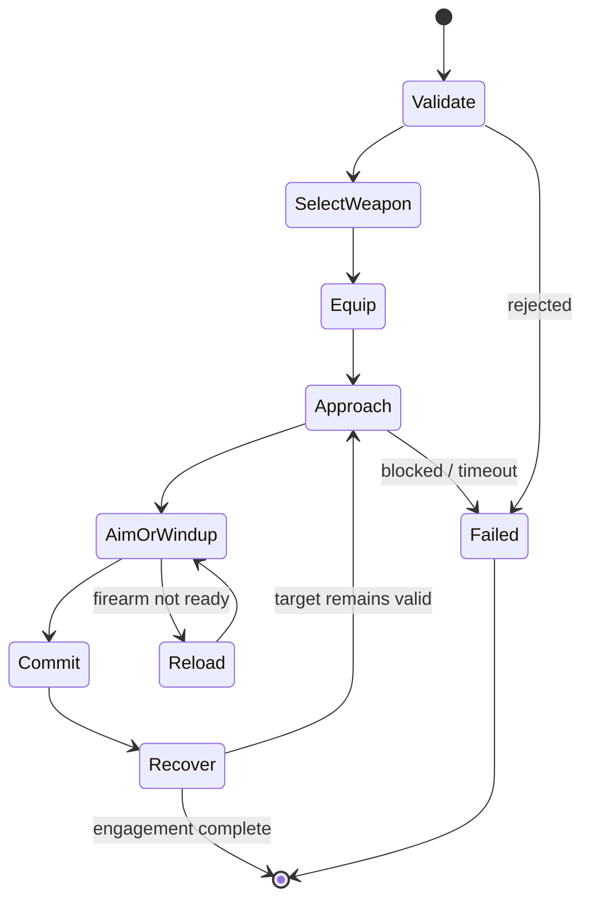

# A-life combat implementation map and our IsoPlayer roadmap

Implementation follow-up: an initial inventory-backed approach/equip/aim and
melee/ranged backend is now implemented in [2026-10-21-npc-combat.md](../features/2026-10-21-npc-combat.md).
Its local tactics follow-up adds distinct spacing bands, reaction delays,
cooldown-limited retreats and bounded attack timing variance; see
[combat tactics and exposure windows](../features/2026-10-21-npc-combat.md#local-combat-tactics-and-exposure-windows).
The investigation/roadmap below records the source analysis preceding that work.

Investigated 2026-10-21. This supplements the
[militia/perception investigation](2026-10-21-npc-militia-patrol-and-threat-perception.md)
and the [implemented engagement scaffold](../features/2026-10-21-npc-engagement.md).

Evidence source: installed
`Z:/SteamLibrary/steamapps/workshop/content/108600/3803984183/mods/ProjectALifeNPCs/42.20/media/lua/`.
All A-life paths below are relative to that root. This is its installed 42.20
Lua implementation, not vanilla 42.21.0 physics or a certified compatible port.

## Separate the meanings of template and preset

A-life combines several distinct inputs, rather than one universal combat mode:

| Input | Meaning | Source |
| --- | --- | --- |
| Actor/profile/faction data | Mission, conduct/doctrine, weapon/loadout plan, allowed capabilities and skill context. | `shared/ProjectALife/Records/ALifeLoadoutProgression.lua`, `ALifeBehaviorSettings.lua`; `server/ProjectALife/Decisions/ALifeDecisionLoop.lua` |
| Engagement policy | Whether this target should be watched, bypassed, defended against, committed to or disengaged from. | `shared/ProjectALife/Decisions/ALifeEngagementPolicy.lua:6` |
| Combat tuning | Standoff, aim/recovery/repath timings, burst length, melee spacing, health/endurance modifiers. | `shared/ProjectALife/Records/ALifeBehaviorSettings.lua:85`; `server/ProjectALife/Combat/ALifeCombatCore.lua:1114` |
| Actual weapon instance | Condition, range, swing/reload type, magazine/chamber/ammo, hands and weapon parts. | `server/ProjectALife/Combat/ALifeWeapons.lua` |
| Animation preset | Concrete held/one-shot presentation, weapon attachment transition, clip timing and variants. | `shared/ProjectALife/Shells/ALifeAnimations.lua:339`, `:387`, `:1232`, `:1676` |

For us: behavior profile chooses an engagement/combat template, a typed combat
configuration governs selection and tactics, a weapon descriptor captures the
real item, and a presentation adapter chooses native player animation/state.
Do not put all of these into a switch on `militia-patrol` or store a weapon enum
inside the current millisecond timing map. `GUARD_BASIC` currently names only a
scaffold template, not a completed preset library.

## Combat lifecycle

`server/ProjectALife/Combat/ALifeCombat.lua:83` builds an engagement with actor
UID/generation, a stamped target identity, aim state and phase deadlines.
The large update routine handles approach, draw reach/draw, aim, melee windup,
recovery, switch, cycling a firearm action, reload/insert/rack, jam/unjam, cover,
kite and reposition. It also checks target liveness, target policy, traversal,
leash and condition. Its ActionLedger wrapper (`:1847`) supplies operation ID,
deadline, recovery limits, cancellation and a safe fallback.

The useful pattern is the explicit per-execution state and bounded transitions.
Our backend should split movement, equipment, aim and weapon execution into
composed services, rather than copying a roughly 1900-line routine. A phase
must have enter/update/exit ownership and a clear failure result; requesting a
path, starting an animation and committing a hit are different milestones.

This is our proposed smaller implementation sequence, not a claim that the
scaffold currently advances these phases. Cancellation can terminate any phase;
a committed hit is never rolled back by cancelling recovery.

## Pathfinding, approach and territory

A-life movement's native path submission uses
`shell:getPathFindBehavior2():pathToLocationF(...)` and its zombie movement/state
machinery (`server/ProjectALife/Movement/ALifeMovement.lua:246`, `:251`, `:310`).
It tracks whether a path started, arrival, stalls, reissues, startup grace and
traversal failure. `ALifeCombatApproach.lua` adds edge/fence handling, route legs,
administrative/home bounds, nearby collision/occupancy probes and footwork.
Combat does not simply path to the exact center of every target every tick.

Its desired point depends on weapon reach and tactic. Melee closing stops short
of the target; firearm closing chooses standoff; close quarters and shotguns
have different distances. `ALifeCombatCore.lua:694..758` separates maximum range,
melee reach/body radius, desired range and engagement reach. These numbers answer
different questions; they should not collapse into one universal attack radius.

Repath is gated by target displacement and time; the inspected settings include
1.5-tile repath displacement, combat repath timings around 600ms, path-startup
grace 1600ms and separate stall handling. They are mod settings with overrides,
not universal native constants. Approach also distinguishes a path that never
started from one that began and stalled (`ALifeCombatApproach.lua:598`, `:602`).

For us, the detached IsoPlayer's normal vanilla path/state update loop is not
running. Calling `pathToLocationF` alone will not wire that loop into our current
manual route integrator. 42.21.0 native evidence is
`decompiled/zombie/pathfind/PathFindBehavior2.java:249`, `:790`, `:1476`, and
`characters/IsoGameCharacter.java:7089`.

First implement a bounded indoor destination planner accepting target position,
preferred stopping distance and a territory traversal constraint. Feed a route
to `ServerHumanMovement`, which remains the sole owner of physical integration
and presentation. Replan after meaningful target displacement, obstruction or
bounded time, with retry/backoff and explicit unreachable outcomes. Never
replace combat approach with another random roam, teleport to reach, or start
both native and manual movement owners. Outdoor paths/stairs/breaching are later
capabilities. A target inside the building does not prove every route to it stays
inside; validate both destination and traversed edges.

## Running intent, bursts and pacing

Running is a policy request, not an unconditional displacement multiplier.
A-life approach grants/checks burst state and considers closing distance,
endurance, target relevance and weapon type before offering a faster pace
(`ALifeCombat.lua:189..218`). It then slows into a guard band near melee reach.
`ALifeCombatCore.lua:102` maintains deterministic actor/cycle closing-run windows;
`shared/ProjectALife/Shells/ALifeGait.lua` supplies burst admission/style.

`ALifeMovement.lua:142` resolves requested pace against injury, danger posture,
flight/hit/sprint effects, endurance and rhythm. Current behavior settings list
850ms run-active / 14000ms cycle, while helper fallbacks differ; use configured
values when comparing behavior. A draw, reload, windup or recovery can stop
locomotion while preserving aim. Melee footwork can retain facing while moving
backward/sideways (`ALifeCombatApproach.lua:862` onward).

Our existing movement resolver already models many of these physical conditions.
The next backend needs explicit WALK/RUN intent through generic move/approach
requests and burst admission as a separate input. Keep one resolved pace driving
server distance, prediction and native flags. Do not let the policy set running
flags or bypass exhaustion/injury. Begin with stop-to-aim/attack; facing and travel
direction must be decoupled before claiming strafing/backpedalling support.

## Weapon availability and selection

`ALifeWeapons.current(:528)` uses inventory candidates, allowed firearms,
active-weapon metadata and ranking. `bestMelee(:591)` excludes bare hands,
requires usable condition and positive melee power, and ranks by max damage.
`bestReloadableRanged(:610)` accepts a loaded or reloadable allowed firearm and
uses ranged preference. `ensureReady(:650)` can fall back to melee when a gun
cannot fire or reload.

`ALifeCombatFire.preferredWeapon(:294)` applies a swap dwell (2000ms), target
context and gun discipline. A currently usable ranged weapon is retained;
an empty gun may stay selected if reloadable, otherwise another ranged weapon or
melee is sought. Zombie missions can prefer melee to avoid noise. Explicit guard
duty in territory can alter that choice; it is not simply "ranged is always best."
`ALifeGunDiscipline.judge(:173)` examines duty, contact crowding, melee availability,
health, allies, noise pressure, horde/route obstruction and a controlled roll.

For us, separate an inventory/equipment adapter, immutable weapon facts and a
pure selection policy. Distinguish no weapon, broken weapon, empty but reloadable,
forbidden firearm, jammed and genuinely ready. Selection should return a reason,
not silently synthesize a weapon. Bind actual item identity at commit; selection
from an earlier inventory snapshot does not reserve or validate it forever.
Define unarmed support explicitly rather than accidentally treating null as a gun.

## Equipping, drawing and animation presets

`ALifeWeapons.select(:549)` primarily marks active item/slot/class metadata.
`Animations.presentWeapon(:814)` then manages attachment location, held state,
grip, hand presentation and model refresh. Draw presets depend on where the item
was carried: holster/belt use reach+draw phases (420/750ms in the inspected helper),
back/two-handed carry uses 450/850ms (`ALifeAnimations.lua:1232`). Weapon transition
can commit at a fraction of a preset's duration rather than at selection time.

Crucial incompatibility: `Animations.presentWeapon` explicitly returns
`player_presentation_forbidden` for IsoPlayer. Its zombie-shell visuals and
client/server rules cannot be transplanted to our players.

For 42.21.0 IsoPlayer, inspect/reuse actual hand items and native Equip replication:
`decompiled/zombie/network/packets/EquipPacket.java:32`, `:44`, `:91` serializes
server item data/visuals and handles shared two-hand item identity.
`ai/states/PlayerAimState.java` and `PlayerStrafeState.java` supply player aim/state
parameters. Implement authoritative hand ownership and replay equipment/aim to new
viewers. A cosmetic prop/emote is not evidence that a weapon is equipped.

## Melee execution

`ALifeCombatStrike.lua:126` defines separate timing families for one/two-handed,
knife, spear, heavy, chainsaw, unarmed, shove and floor attacks. `meleeTiming`
scales those timings using weapon/native-style swing information. Aim readiness,
windup and recovery are distinct from target approach. Endurance/injury affect
tempo and damage; close crowding can trigger shoves and bounded footwork.

At strike, `resolveAttack(:1118)` checks target policy, incapacity, cadence, reach,
boundary/line and weapon. `strikeZombie(:843)` calculates custom wound/crit,
subtracts zombie health, calls Kill when needed and presents reactions. It is
an explicit damage path, not merely a vanilla player attack input.

Our first melee backend should equip one real weapon, approach a reachable
stopping point, face, wind up, commit once, then recover. Revalidate live target
identity, weapon identity/condition, floor, reach and clear boundary at commit.
Similarly named attack methods do not establish equivalent hit execution:
42.21.0 `ai/states/SwipeStatePlayer.java:280..300` gates collision-driven attack
calculation on a local player. Our remote detached player needs server-owned
commit timing and tested result replication. Preserve miss presentation and
cancel-before-commit versus cancel-after-commit semantics.

## Firearms, ammo, aim and reload

Ranged selection and shot execution are separate. `ALifeCombatFire.lua` handles
ready/shot/reload/rack/jam presets, burst composition, aim settle/ramp, effective
range/falloff, shot effects and world sound. `ALifeFireControl.lua:7` adds line
caches, ray budgets, squad admission and lane search, including vehicles.
Visibility alone is not a clear firearm lane or a friendly-fire policy.

`ALifeWeapons.lua:196` builds a reload transaction; `:222` commits once, increments
loaded ammunition and debits reserve. It distinguishes external magazines,
internal magazines and per-round versus fill-to-capacity loading. Combat schedules
the insert partway through reload and can proceed to rack/cycle phases.
`consumeRound(:246)` is separate from deciding that a gun is reloadable. Revolver,
automatic, pellet and bolt/rack behaviors have their own helpers (`:324..440`).

At ranged commit, A-life consumes a round before hit resolution
(`ALifeCombatStrike.lua:1236`), applies aim/skill/injury/range/burst chance, emits
noise/shot effects even for misses, and dispatches damage via target-specific
paths. NPC-to-NPC/client-owner operations additionally use the hit relay's
ownership/generation, paid-attack and duplicate-victim checks. Native player
damage and zombie damage are not the same operation.

For our backend, implement ammo/chamber/reserve semantics with explicit commit
points before adding automatic bursts, jams or fancy firing doctrines. A miss
still spends ammo and emits a shot. Cancelling reload before insertion must not
grant ammunition; cancellation afterward preserves the committed inventory change.
Add server-authoritative world stimuli once, independently of per-viewer effects.
The current scaffold does not add inventory persistence or any firearm state.

## Suggested implementation slices

1. **Approach capability:** bounded indoor destination/path planning, movement
   intent and cancellation; WALK/RUN test routes, target displacement/repath,
   territory leash and unreachable reporting. No attack yet.
2. **Equipment + facing/aim:** real item ownership and hands, native equip/state
   replication including late viewers; one melee weapon; stationary stance.
3. **Melee phase engine:** timed windup/one-shot commit/recovery, reach/boundary
   revalidation, zombie damage and reaction/death replication with two clients.
4. **Reciprocal zombie integration:** prey targeting, client zombie ownership,
   NPC hit lookup, canonical health mutation, reaction/death cleanup. Do not
   globally remove guide god mode or put detached NPCs in player-account lists.
5. **Firearm phase engine:** aim, a single shot, ammo/reload/rack, miss/noise and
   shot replication. Then burst/jam/support weapon classes and advanced footwork.
6. **Doctrine/preset expansion:** typed templates and tuned weapon families,
   richer engagement/fight-flight policy, squad lanes and faction rules.

Each slice should preserve the implemented policy/request/execution boundary and
existing movement packet cadence. No source inspection alone validates animation
speed, shot presentation or multiplayer damage; those require controlled live
tests. The installed A-life numeric settings are evidence of separation and
inputs, not automatically suitable balance values for our normalized physical
state or our native player presentation.
